# Intended-design UI references

Generated visual design targets for all 50 owning app groups. **Desktop only, with a shared left sidebar and bottom-left account menu.** Built-in imagegen, 13 October 2026. These are intended designs; no working frontend, runtime screenshot or passing E2E result is claimed.

Each owning reference directory contains PNGs, an image gallery with route/state/viewport/expectations/limitations, and exact generation prompts. Original pre-task Affiliate and Table images remain as superseded provenance; their layouts and omissions are not active comparison targets. Earlier right-sidebar and withdrawn-mobile requests in prompt history are superseded by the final desktop requests.

## Comparison expectations

Flag meaningful differences in layout, hierarchy, missing source content or controls, readable typography/contrast, responsive behavior and state presentation. Ignore harmless antialiasing, tiny spacing differences, equivalent typography and illustrative sample-data differences. Source `.can` and companion requirements take precedence over image-generation errors; never promote an accidental image control, omitted field, wrong caption or inconsistent sample state into a product requirement.

The desktop-only reference scope does not remove existing responsive runtime requirements. Loading, empty/no-match, failed, stale, pending/unknown and successful outcomes remain distinct even when their shared layout is represented once. Per-app galleries describe grouped pages and unpictured variants. Language/theme variants and every possible data combination are not separately generated.

The 50 folders own the focused drafts. Seven named portfolio compositions reuse their member apps’ references under [the existing composition plan](PORTFOLIO.md); they are not duplicate app folders or new shell/permission schemas. No extra composition-specific image or executed integration is claimed.

## App index

| App | Active desktop targets | Gallery and exact prompts |
| --- | ---: | --- |
| [CanAffiliate](#canaffiliate) | 3 | [Gallery](apps/CanAffiliate/playwright/references/README.md) · [Prompts](apps/CanAffiliate/playwright/references/prompts.md) |
| [CanApprove](#canapprove) | 2 | [Gallery](apps/CanApprove/playwright/references/README.md) · [Prompts](apps/CanApprove/playwright/references/prompts.md) |
| [CanBoard](#canboard) | 2 | [Gallery](apps/CanBoard/playwright/references/README.md) · [Prompts](apps/CanBoard/playwright/references/prompts.md) |
| [CanBook](#canbook) | 2 | [Gallery](apps/CanBook/playwright/references/README.md) · [Prompts](apps/CanBook/playwright/references/prompts.md) |
| [CanCRM](#cancrm) | 2 | [Gallery](apps/CanCRM/playwright/references/README.md) · [Prompts](apps/CanCRM/playwright/references/prompts.md) |
| [CanCatch](#cancatch) | 1 | [Gallery](apps/CanCatch/playwright/references/README.md) · [Prompts](apps/CanCatch/playwright/references/prompts.md) |
| [CanChat](#canchat) | 3 | [Gallery](apps/CanChat/playwright/references/README.md) · [Prompts](apps/CanChat/playwright/references/prompts.md) |
| [CanCheck](#cancheck) | 1 | [Gallery](apps/CanCheck/playwright/references/README.md) · [Prompts](apps/CanCheck/playwright/references/prompts.md) |
| [CanContract](#cancontract) | 1 | [Gallery](apps/CanContract/playwright/references/README.md) · [Prompts](apps/CanContract/playwright/references/prompts.md) |
| [CanCreative](#cancreative) | 4 | [Gallery](apps/CanCreative/playwright/references/README.md) · [Prompts](apps/CanCreative/playwright/references/prompts.md) |
| [CanCustomer](#cancustomer) | 4 | [Gallery](apps/CanCustomer/playwright/references/README.md) · [Prompts](apps/CanCustomer/playwright/references/prompts.md) |
| [CanDecide](#candecide) | 2 | [Gallery](apps/CanDecide/playwright/references/README.md) · [Prompts](apps/CanDecide/playwright/references/prompts.md) |
| [CanDesk](#candesk) | 2 | [Gallery](apps/CanDesk/playwright/references/README.md) · [Prompts](apps/CanDesk/playwright/references/prompts.md) |
| [CanDiscover](#candiscover) | 2 | [Gallery](apps/CanDiscover/playwright/references/README.md) · [Prompts](apps/CanDiscover/playwright/references/prompts.md) |
| [CanDo](#cando) | 2 | [Gallery](apps/CanDo/playwright/references/README.md) · [Prompts](apps/CanDo/playwright/references/prompts.md) |
| [CanEnrich](#canenrich) | 1 | [Gallery](apps/CanEnrich/playwright/references/README.md) · [Prompts](apps/CanEnrich/playwright/references/prompts.md) |
| [CanEvent](#canevent) | 2 | [Gallery](apps/CanEvent/playwright/references/README.md) · [Prompts](apps/CanEvent/playwright/references/prompts.md) |
| [CanExpense](#canexpense) | 2 | [Gallery](apps/CanExpense/playwright/references/README.md) · [Prompts](apps/CanExpense/playwright/references/prompts.md) |
| [CanFeedback](#canfeedback) | 2 | [Gallery](apps/CanFeedback/playwright/references/README.md) · [Prompts](apps/CanFeedback/playwright/references/prompts.md) |
| [CanField](#canfield) | 2 | [Gallery](apps/CanField/playwright/references/README.md) · [Prompts](apps/CanField/playwright/references/prompts.md) |
| [CanGallery](#cangallery) | 2 | [Gallery](apps/CanGallery/playwright/references/README.md) · [Prompts](apps/CanGallery/playwright/references/prompts.md) |
| [CanGrant](#cangrant) | 2 | [Gallery](apps/CanGrant/playwright/references/README.md) · [Prompts](apps/CanGrant/playwright/references/prompts.md) |
| [CanHire](#canhire) | 2 | [Gallery](apps/CanHire/playwright/references/README.md) · [Prompts](apps/CanHire/playwright/references/prompts.md) |
| [CanInbox](#caninbox) | 2 | [Gallery](apps/CanInbox/playwright/references/README.md) · [Prompts](apps/CanInbox/playwright/references/prompts.md) |
| [CanInvoice](#caninvoice) | 2 | [Gallery](apps/CanInvoice/playwright/references/README.md) · [Prompts](apps/CanInvoice/playwright/references/prompts.md) |
| [CanKnowledge](#canknowledge) | 2 | [Gallery](apps/CanKnowledge/playwright/references/README.md) · [Prompts](apps/CanKnowledge/playwright/references/prompts.md) |
| [CanLearn](#canlearn) | 2 | [Gallery](apps/CanLearn/playwright/references/README.md) · [Prompts](apps/CanLearn/playwright/references/prompts.md) |
| [CanLeave](#canleave) | 3 | [Gallery](apps/CanLeave/playwright/references/README.md) · [Prompts](apps/CanLeave/playwright/references/prompts.md) |
| [CanLoyalty](#canloyalty) | 3 | [Gallery](apps/CanLoyalty/playwright/references/README.md) · [Prompts](apps/CanLoyalty/playwright/references/prompts.md) |
| [CanMail](#canmail) | 2 | [Gallery](apps/CanMail/playwright/references/README.md) · [Prompts](apps/CanMail/playwright/references/prompts.md) |
| [CanMaintain](#canmaintain) | 2 | [Gallery](apps/CanMaintain/playwright/references/README.md) · [Prompts](apps/CanMaintain/playwright/references/prompts.md) |
| [CanMember](#canmember) | 5 | [Gallery](apps/CanMember/playwright/references/README.md) · [Prompts](apps/CanMember/playwright/references/prompts.md) |
| [CanOnboard](#canonboard) | 2 | [Gallery](apps/CanOnboard/playwright/references/README.md) · [Prompts](apps/CanOnboard/playwright/references/prompts.md) |
| [CanPromptLab](#canpromptlab) | 3 | [Gallery](apps/CanPromptLab/playwright/references/README.md) · [Prompts](apps/CanPromptLab/playwright/references/prompts.md) |
| [CanPropose](#canpropose) | 2 | [Gallery](apps/CanPropose/playwright/references/README.md) · [Prompts](apps/CanPropose/playwright/references/prompts.md) |
| [CanPurchase](#canpurchase) | 2 | [Gallery](apps/CanPurchase/playwright/references/README.md) · [Prompts](apps/CanPurchase/playwright/references/prompts.md) |
| [CanReception](#canreception) | 3 | [Gallery](apps/CanReception/playwright/references/README.md) · [Prompts](apps/CanReception/playwright/references/prompts.md) |
| [CanRefer](#canrefer) | 3 | [Gallery](apps/CanRefer/playwright/references/README.md) · [Prompts](apps/CanRefer/playwright/references/prompts.md) |
| [CanRent](#canrent) | 5 | [Gallery](apps/CanRent/playwright/references/README.md) · [Prompts](apps/CanRent/playwright/references/prompts.md) |
| [CanReport](#canreport) | 1 | [Gallery](apps/CanReport/playwright/references/README.md) · [Prompts](apps/CanReport/playwright/references/prompts.md) |
| [CanShift](#canshift) | 2 | [Gallery](apps/CanShift/playwright/references/README.md) · [Prompts](apps/CanShift/playwright/references/prompts.md) |
| [CanStats](#canstats) | 1 | [Gallery](apps/CanStats/playwright/references/README.md) · [Prompts](apps/CanStats/playwright/references/prompts.md) |
| [CanStock](#canstock) | 2 | [Gallery](apps/CanStock/playwright/references/README.md) · [Prompts](apps/CanStock/playwright/references/prompts.md) |
| [CanSuccess](#cansuccess) | 1 | [Gallery](apps/CanSuccess/playwright/references/README.md) · [Prompts](apps/CanSuccess/playwright/references/prompts.md) |
| [CanSync](#cansync) | 1 | [Gallery](apps/CanSync/playwright/references/README.md) · [Prompts](apps/CanSync/playwright/references/prompts.md) |
| [CanTable](#cantable) | 1 | [Gallery](apps/CanTable/playwright/references/README.md) · [Prompts](apps/CanTable/playwright/references/prompts.md) |
| [CanTime](#cantime) | 2 | [Gallery](apps/CanTime/playwright/references/README.md) · [Prompts](apps/CanTime/playwright/references/prompts.md) |
| [CanTrade](#cantrade) | 2 | [Gallery](apps/CanTrade/playwright/references/README.md) · [Prompts](apps/CanTrade/playwright/references/prompts.md) |
| [CanVolunteer](#canvolunteer) | 3 | [Gallery](apps/CanVolunteer/playwright/references/README.md) · [Prompts](apps/CanVolunteer/playwright/references/prompts.md) |
| [CanWorkbench](#canworkbench) | 1 | [Gallery](apps/CanWorkbench/playwright/references/README.md) · [Prompts](apps/CanWorkbench/playwright/references/prompts.md) |

Current target count: 108 active desktop images, plus 2 preserved superseded images. No app exceeds 5 active references; distinct but equivalent table/form/detail layouts share their documented patterns.

## CanAffiliate

[3 active desktop references and coverage notes](apps/CanAffiliate/playwright/references/README.md) · [Exact prompts](apps/CanAffiliate/playwright/references/prompts.md) · [Authored source](apps/CanAffiliate/CanAffiliate.can) · [Requirements](apps/CanAffiliate/CanAffiliate.md)

## CanApprove

[2 active desktop references and coverage notes](apps/CanApprove/playwright/references/README.md) · [Exact prompts](apps/CanApprove/playwright/references/prompts.md) · [Authored source](apps/CanApprove/CanApprove.can) · [Requirements](apps/CanApprove/CanApprove.md)

## CanBoard

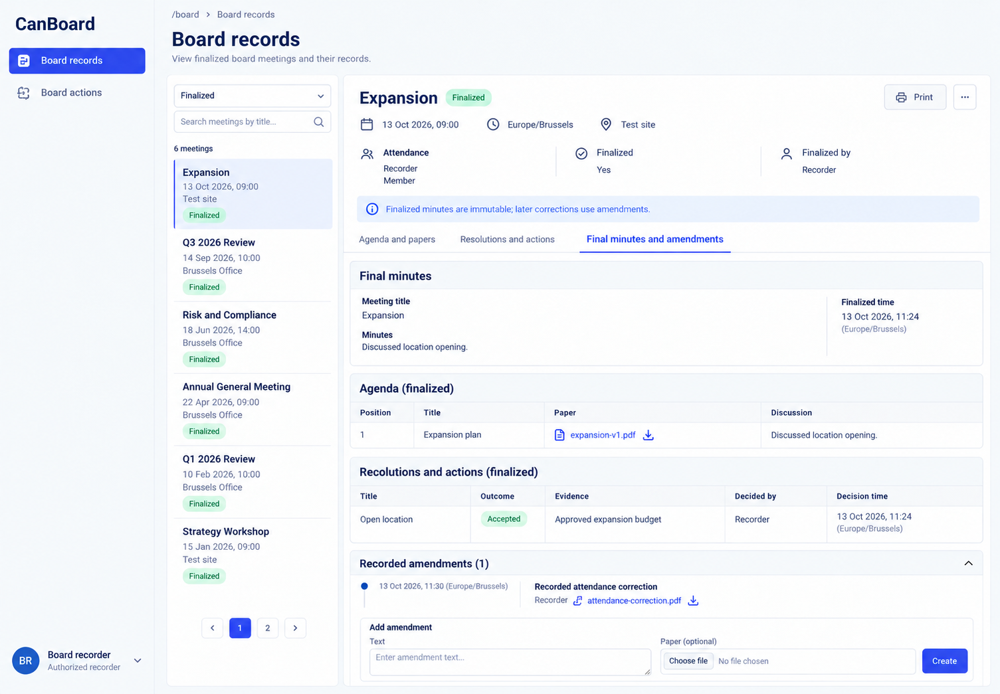

[2 active desktop references and coverage notes](apps/CanBoard/playwright/references/README.md) · [Exact prompts](apps/CanBoard/playwright/references/prompts.md) · [Authored source](apps/CanBoard/CanBoard.can) · [Requirements](apps/CanBoard/CanBoard.md)

## CanBook

[2 active desktop references and coverage notes](apps/CanBook/playwright/references/README.md) · [Exact prompts](apps/CanBook/playwright/references/prompts.md) · [Authored source](apps/CanBook/CanBook.can) · [Requirements](apps/CanBook/CanBook.md)

## CanCRM

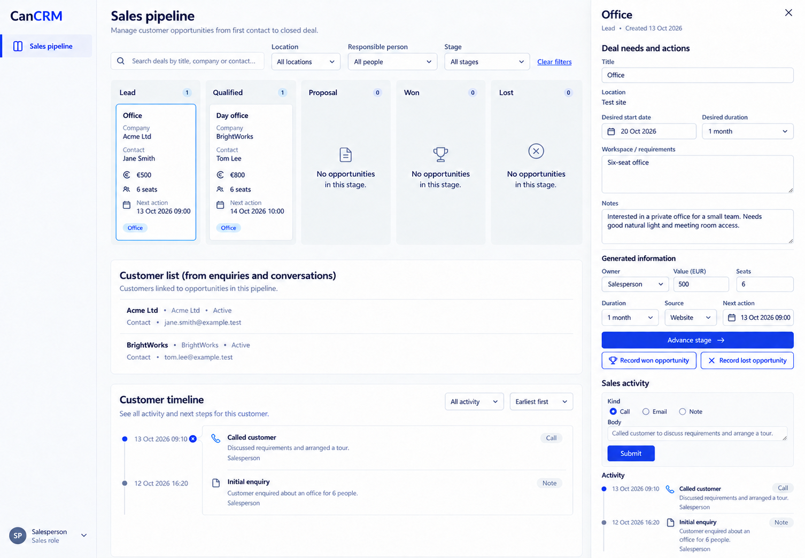

[2 active desktop references and coverage notes](apps/CanCRM/playwright/references/README.md) · [Exact prompts](apps/CanCRM/playwright/references/prompts.md) · [Authored source](apps/CanCRM/CanCRM.can) · [Requirements](apps/CanCRM/CanCRM.md)

## CanCatch

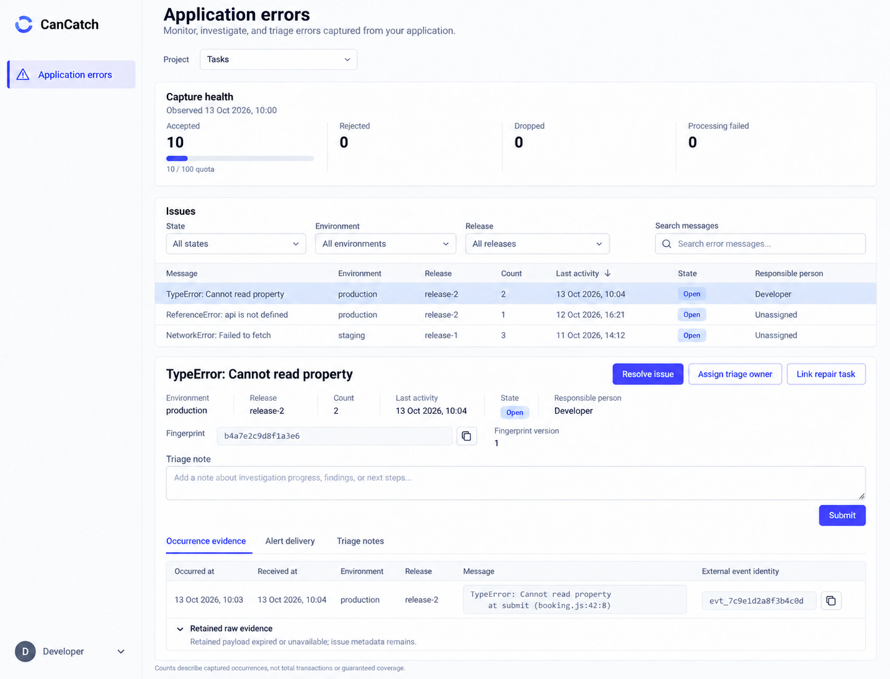

[1 active desktop reference and coverage notes](apps/CanCatch/playwright/references/README.md) · [Exact prompts](apps/CanCatch/playwright/references/prompts.md) · [Authored source](apps/CanCatch/CanCatch.can) · [Requirements](apps/CanCatch/CanCatch.md)

## CanChat

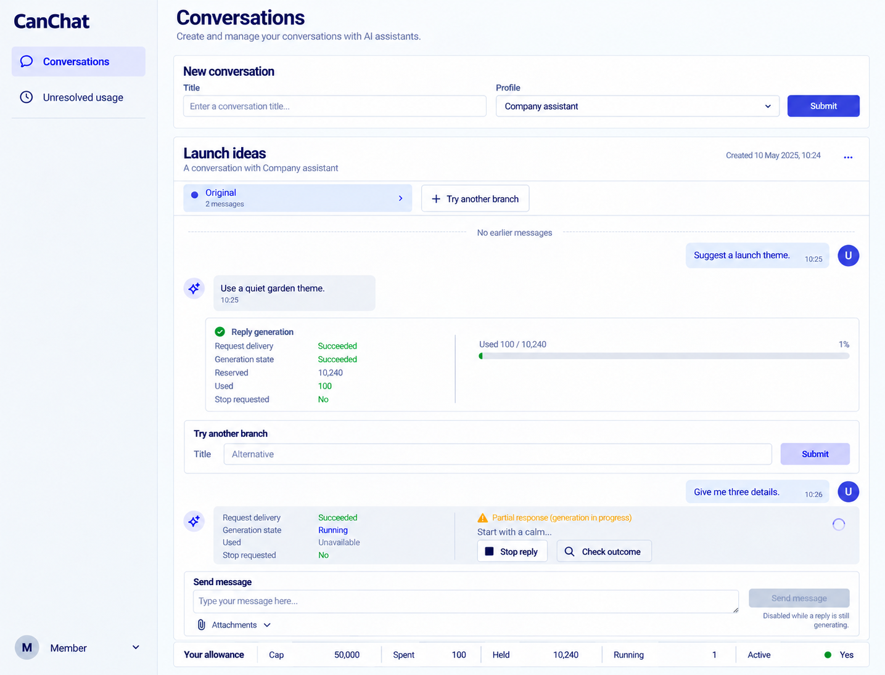

[3 active desktop references and coverage notes](apps/CanChat/playwright/references/README.md) · [Exact prompts](apps/CanChat/playwright/references/prompts.md) · [Authored source](apps/CanChat/CanChat.can) · [Requirements](apps/CanChat/CanChat.md)

## CanCheck

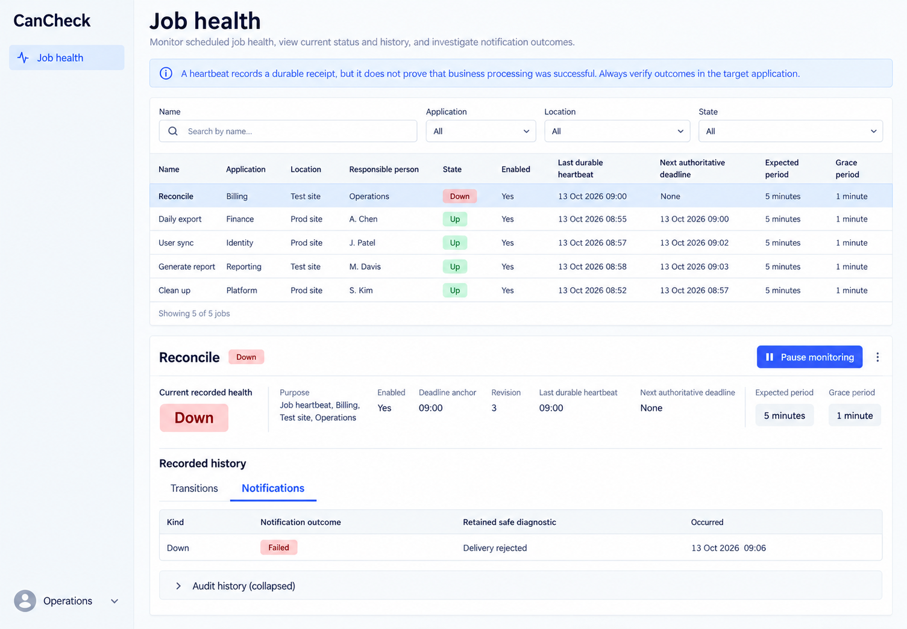

[1 active desktop reference and coverage notes](apps/CanCheck/playwright/references/README.md) · [Exact prompts](apps/CanCheck/playwright/references/prompts.md) · [Authored source](apps/CanCheck/CanCheck.can) · [Requirements](apps/CanCheck/CanCheck.md)

## CanContract

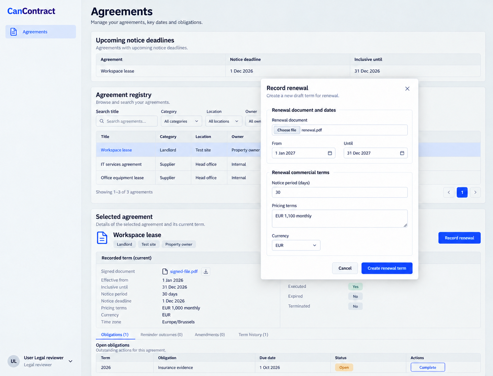

[1 active desktop reference and coverage notes](apps/CanContract/playwright/references/README.md) · [Exact prompts](apps/CanContract/playwright/references/prompts.md) · [Authored source](apps/CanContract/CanContract.can) · [Requirements](apps/CanContract/CanContract.md)

## CanCreative

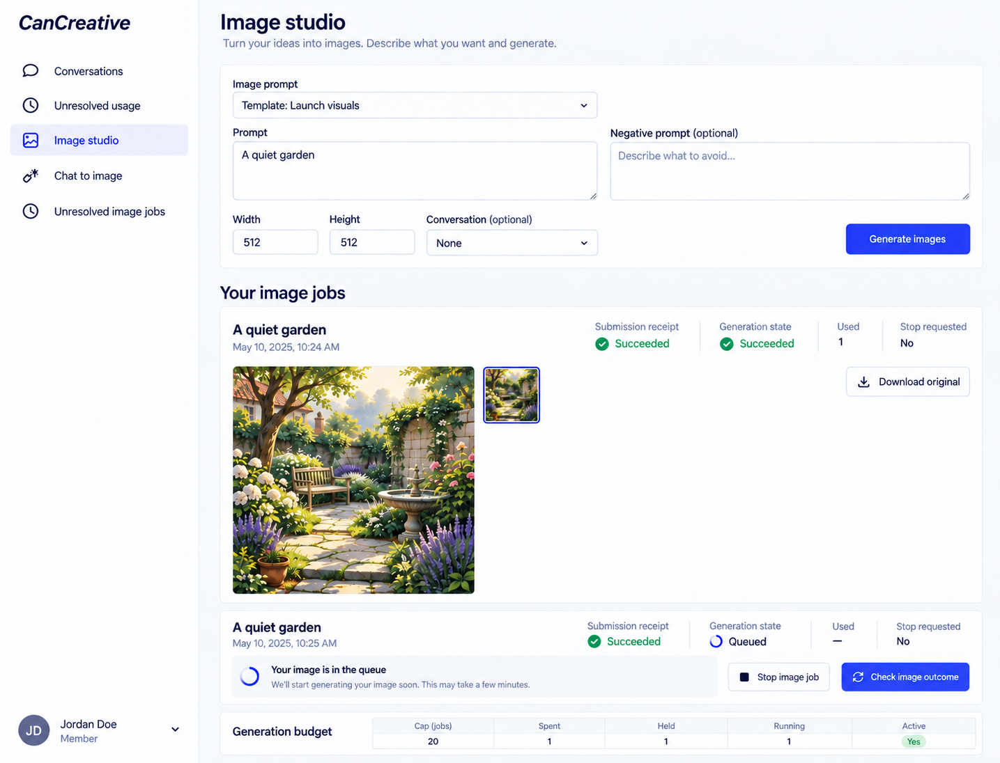

[4 active desktop references and coverage notes](apps/CanCreative/playwright/references/README.md) · [Exact prompts](apps/CanCreative/playwright/references/prompts.md) · [Authored source](apps/CanCreative/CanCreative.can) · [Requirements](apps/CanCreative/CanCreative.md)

## CanCustomer

[4 active desktop references and coverage notes](apps/CanCustomer/playwright/references/README.md) · [Exact prompts](apps/CanCustomer/playwright/references/prompts.md) · [Authored source](apps/CanCustomer/CanCustomer.can) · [Requirements](apps/CanCustomer/CanCustomer.md)

## CanDecide

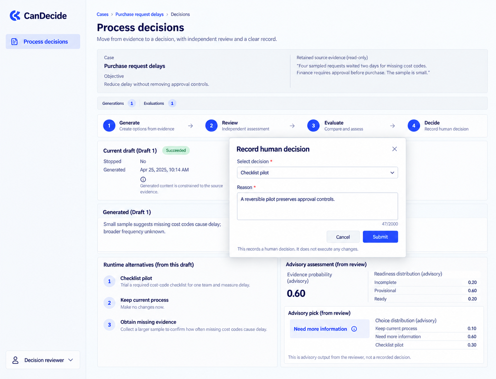

[2 active desktop references and coverage notes](apps/CanDecide/playwright/references/README.md) · [Exact prompts](apps/CanDecide/playwright/references/prompts.md) · [Authored source](apps/CanDecide/CanDecide.can) · [Requirements](apps/CanDecide/CanDecide.md)

## CanDesk

[2 active desktop references and coverage notes](apps/CanDesk/playwright/references/README.md) · [Exact prompts](apps/CanDesk/playwright/references/prompts.md) · [Authored source](apps/CanDesk/CanDesk.can) · [Requirements](apps/CanDesk/CanDesk.md)

## CanDiscover

[2 active desktop references and coverage notes](apps/CanDiscover/playwright/references/README.md) · [Exact prompts](apps/CanDiscover/playwright/references/prompts.md) · [Authored source](apps/CanDiscover/CanDiscover.can) · [Requirements](apps/CanDiscover/CanDiscover.md)

## CanDo

[2 active desktop references and coverage notes](apps/CanDo/playwright/references/README.md) · [Exact prompts](apps/CanDo/playwright/references/prompts.md) · [Authored source](apps/CanDo/CanDo.can) · [Requirements](apps/CanDo/CanDo.md)

## CanEnrich

[1 active desktop reference and coverage notes](apps/CanEnrich/playwright/references/README.md) · [Exact prompts](apps/CanEnrich/playwright/references/prompts.md) · [Authored source](apps/CanEnrich/CanEnrich.can) · [Requirements](apps/CanEnrich/CanEnrich.md)

## CanEvent

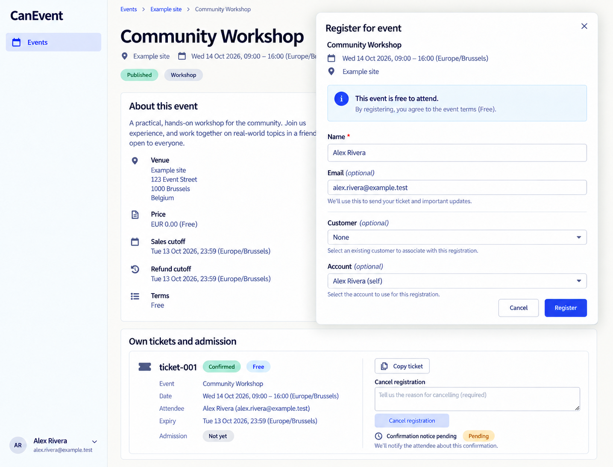

[2 active desktop references and coverage notes](apps/CanEvent/playwright/references/README.md) · [Exact prompts](apps/CanEvent/playwright/references/prompts.md) · [Authored source](apps/CanEvent/CanEvent.can) · [Requirements](apps/CanEvent/CanEvent.md)

## CanExpense

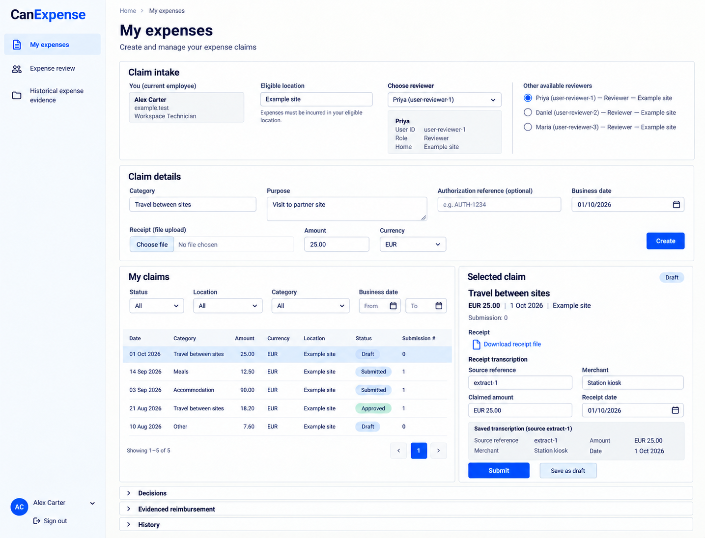

[2 active desktop references and coverage notes](apps/CanExpense/playwright/references/README.md) · [Exact prompts](apps/CanExpense/playwright/references/prompts.md) · [Authored source](apps/CanExpense/CanExpense.can) · [Requirements](apps/CanExpense/CanExpense.md)

## CanFeedback

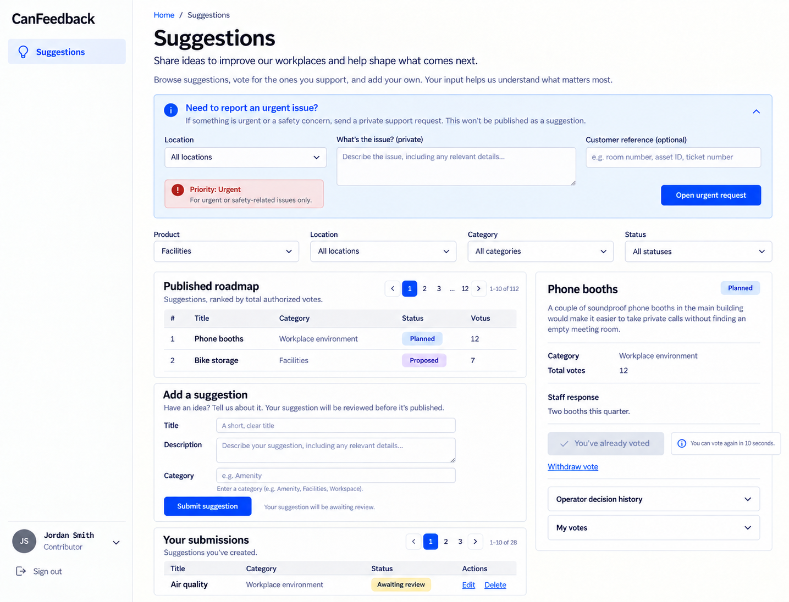

[2 active desktop references and coverage notes](apps/CanFeedback/playwright/references/README.md) · [Exact prompts](apps/CanFeedback/playwright/references/prompts.md) · [Authored source](apps/CanFeedback/CanFeedback.can) · [Requirements](apps/CanFeedback/CanFeedback.md)

## CanField

[2 active desktop references and coverage notes](apps/CanField/playwright/references/README.md) · [Exact prompts](apps/CanField/playwright/references/prompts.md) · [Authored source](apps/CanField/CanField.can) · [Requirements](apps/CanField/CanField.md)

## CanGallery

[2 active desktop references and coverage notes](apps/CanGallery/playwright/references/README.md) · [Exact prompts](apps/CanGallery/playwright/references/prompts.md) · [Authored source](apps/CanGallery/CanGallery.can) · [Requirements](apps/CanGallery/CanGallery.md)

## CanGrant

[2 active desktop references and coverage notes](apps/CanGrant/playwright/references/README.md) · [Exact prompts](apps/CanGrant/playwright/references/prompts.md) · [Authored source](apps/CanGrant/CanGrant.can) · [Requirements](apps/CanGrant/CanGrant.md)

## CanHire

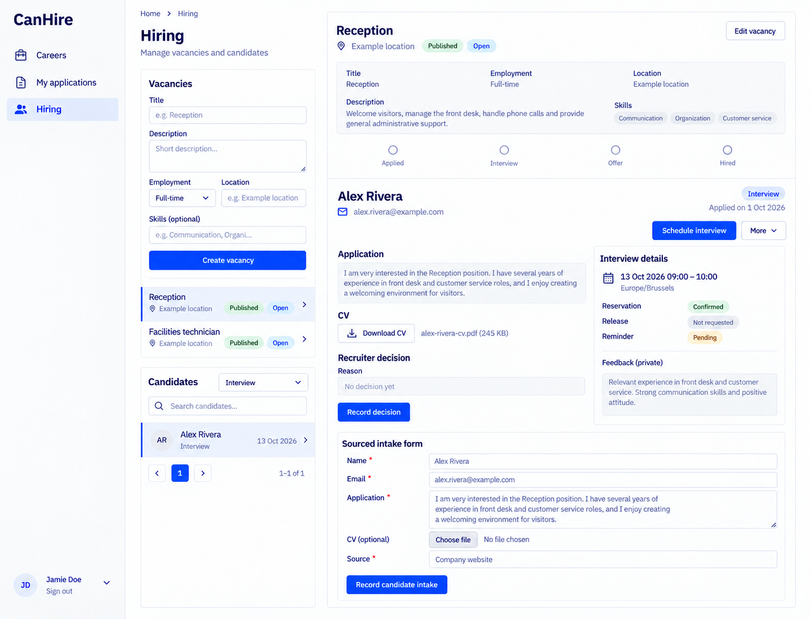

[2 active desktop references and coverage notes](apps/CanHire/playwright/references/README.md) · [Exact prompts](apps/CanHire/playwright/references/prompts.md) · [Authored source](apps/CanHire/CanHire.can) · [Requirements](apps/CanHire/CanHire.md)

## CanInbox

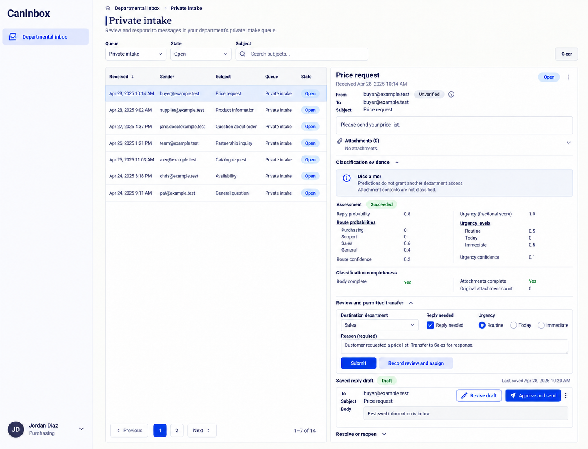

[2 active desktop references and coverage notes](apps/CanInbox/playwright/references/README.md) · [Exact prompts](apps/CanInbox/playwright/references/prompts.md) · [Authored source](apps/CanInbox/CanInbox.can) · [Requirements](apps/CanInbox/CanInbox.md)

## CanInvoice

[2 active desktop references and coverage notes](apps/CanInvoice/playwright/references/README.md) · [Exact prompts](apps/CanInvoice/playwright/references/prompts.md) · [Authored source](apps/CanInvoice/CanInvoice.can) · [Requirements](apps/CanInvoice/CanInvoice.md)

## CanKnowledge

[2 active desktop references and coverage notes](apps/CanKnowledge/playwright/references/README.md) · [Exact prompts](apps/CanKnowledge/playwright/references/prompts.md) · [Authored source](apps/CanKnowledge/CanKnowledge.can) · [Requirements](apps/CanKnowledge/CanKnowledge.md)

## CanLearn

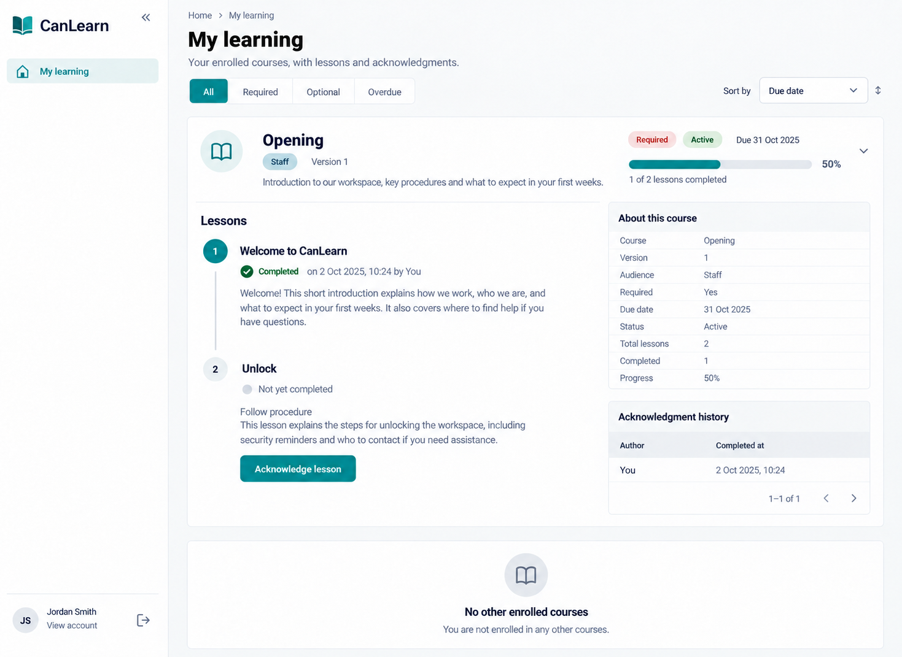

[2 active desktop references and coverage notes](apps/CanLearn/playwright/references/README.md) · [Exact prompts](apps/CanLearn/playwright/references/prompts.md) · [Authored source](apps/CanLearn/CanLearn.can) · [Requirements](apps/CanLearn/CanLearn.md)

## CanLeave

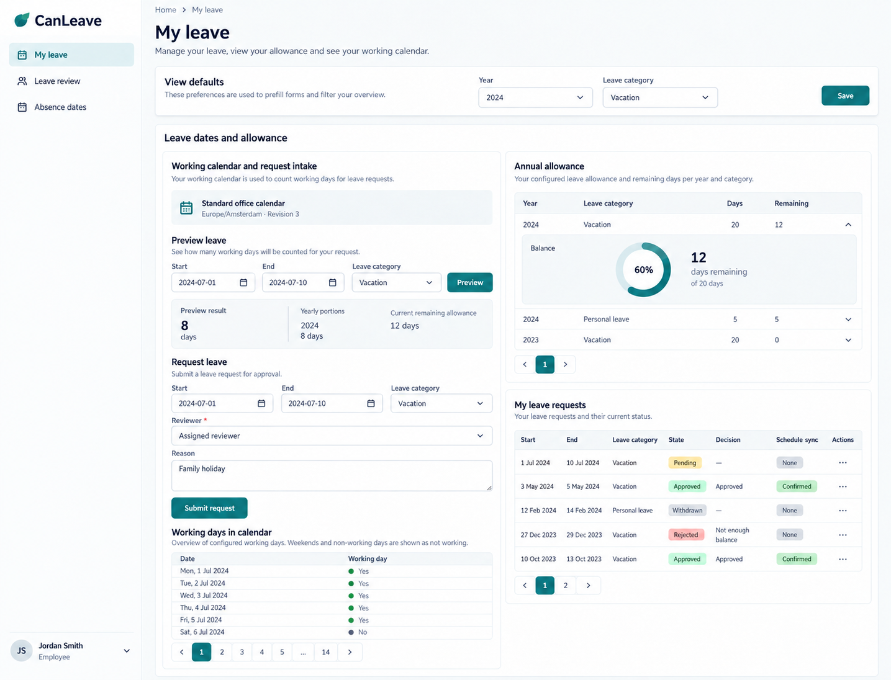

[3 active desktop references and coverage notes](apps/CanLeave/playwright/references/README.md) · [Exact prompts](apps/CanLeave/playwright/references/prompts.md) · [Authored source](apps/CanLeave/CanLeave.can) · [Requirements](apps/CanLeave/CanLeave.md)

## CanLoyalty

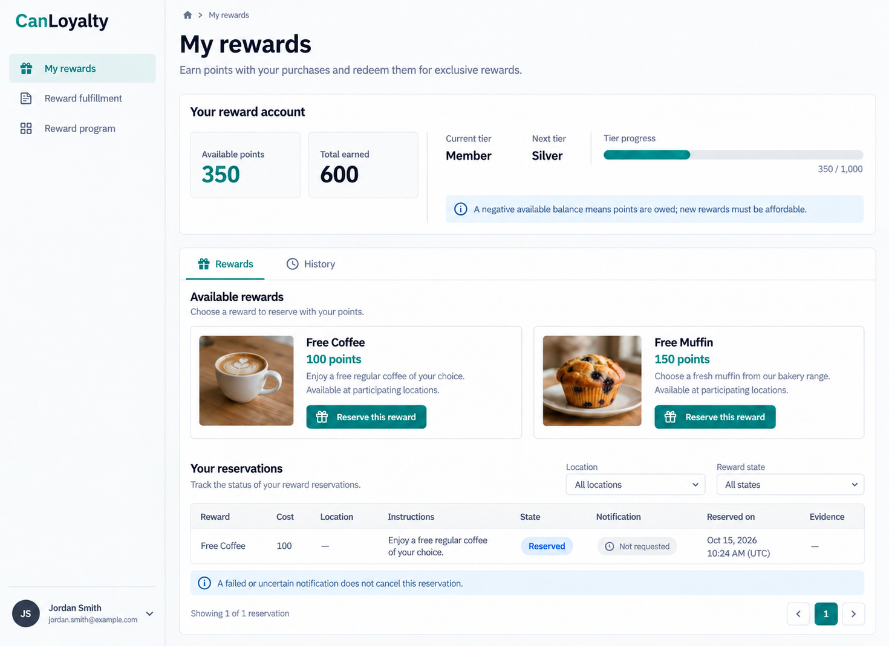

[3 active desktop references and coverage notes](apps/CanLoyalty/playwright/references/README.md) · [Exact prompts](apps/CanLoyalty/playwright/references/prompts.md) · [Authored source](apps/CanLoyalty/CanLoyalty.can) · [Requirements](apps/CanLoyalty/CanLoyalty.md)

## CanMail

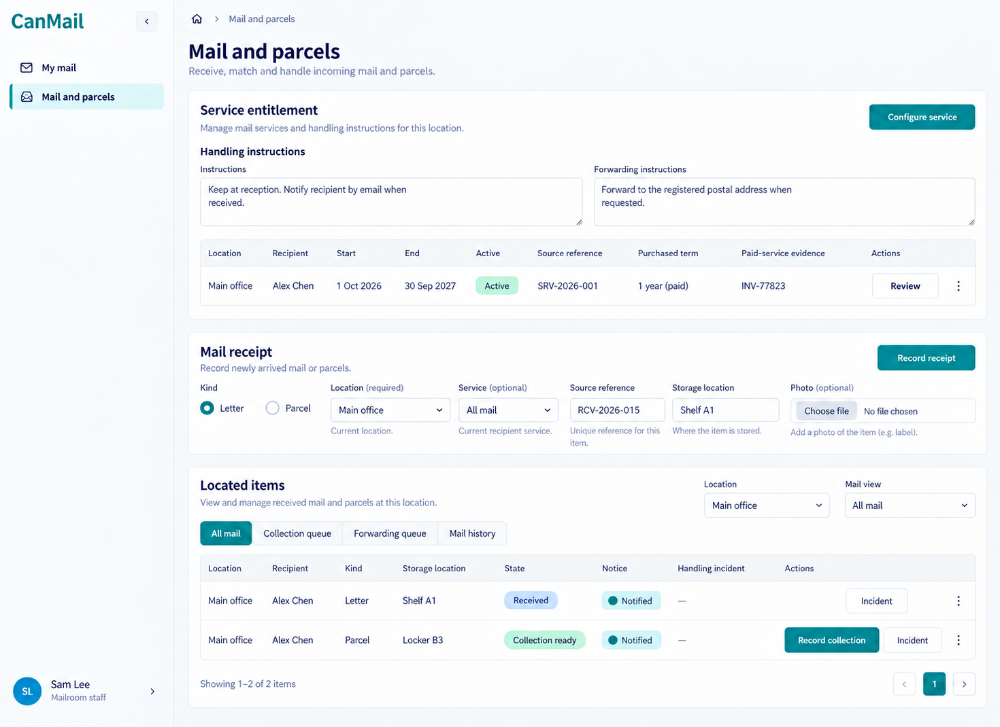

[2 active desktop references and coverage notes](apps/CanMail/playwright/references/README.md) · [Exact prompts](apps/CanMail/playwright/references/prompts.md) · [Authored source](apps/CanMail/CanMail.can) · [Requirements](apps/CanMail/CanMail.md)

## CanMaintain

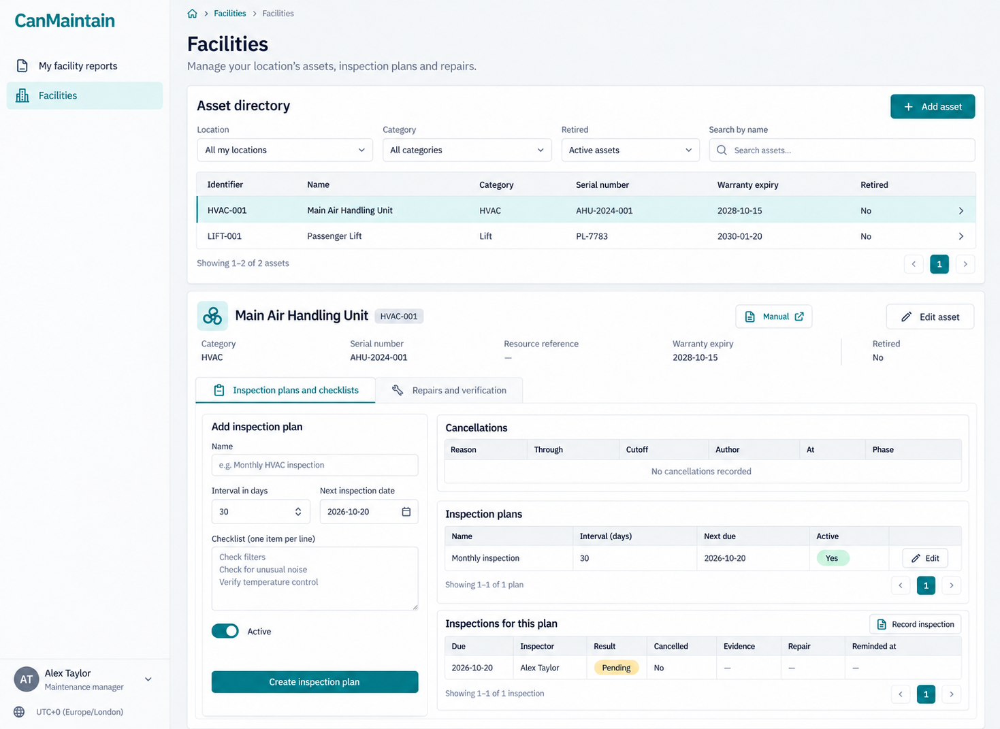

[2 active desktop references and coverage notes](apps/CanMaintain/playwright/references/README.md) · [Exact prompts](apps/CanMaintain/playwright/references/prompts.md) · [Authored source](apps/CanMaintain/CanMaintain.can) · [Requirements](apps/CanMaintain/CanMaintain.md)

## CanMember

[5 active desktop references and coverage notes](apps/CanMember/playwright/references/README.md) · [Exact prompts](apps/CanMember/playwright/references/prompts.md) · [Authored source](apps/CanMember/CanMember.can) · [Requirements](apps/CanMember/CanMember.md)

## CanOnboard

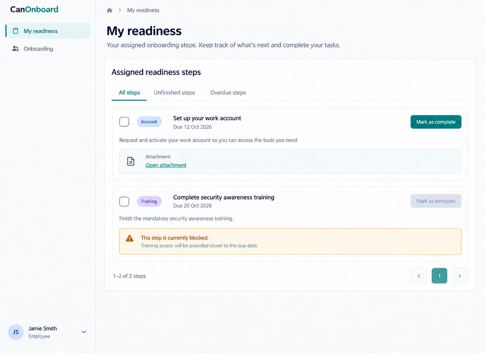

[2 active desktop references and coverage notes](apps/CanOnboard/playwright/references/README.md) · [Exact prompts](apps/CanOnboard/playwright/references/prompts.md) · [Authored source](apps/CanOnboard/CanOnboard.can) · [Requirements](apps/CanOnboard/CanOnboard.md)

## CanPromptLab

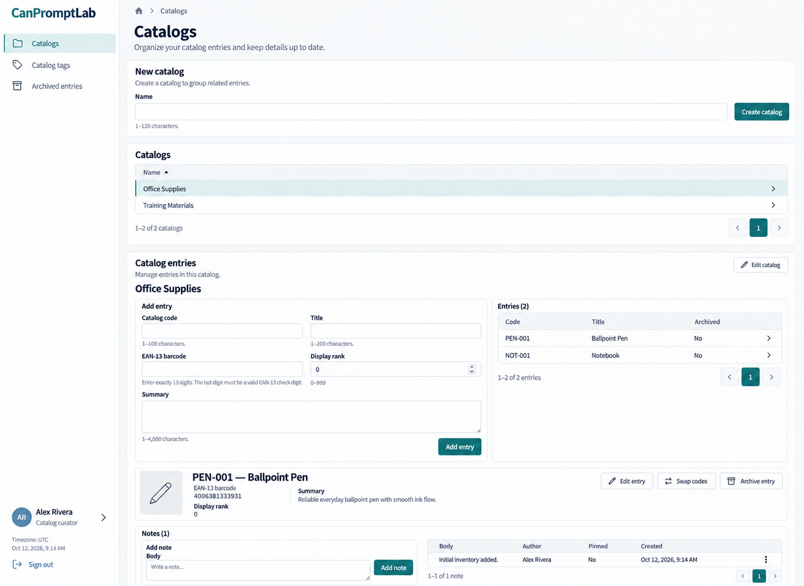

[3 active desktop references and coverage notes](apps/CanPromptLab/playwright/references/README.md) · [Exact prompts](apps/CanPromptLab/playwright/references/prompts.md) · [Authored source](apps/CanPromptLab/CanPromptLab.can) · [Requirements](apps/CanPromptLab/CanPromptLab.md)

## CanPropose

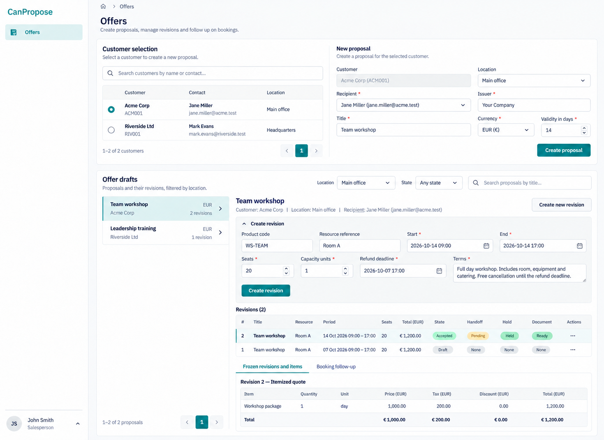

[2 active desktop references and coverage notes](apps/CanPropose/playwright/references/README.md) · [Exact prompts](apps/CanPropose/playwright/references/prompts.md) · [Authored source](apps/CanPropose/CanPropose.can) · [Requirements](apps/CanPropose/CanPropose.md)

## CanPurchase

[2 active desktop references and coverage notes](apps/CanPurchase/playwright/references/README.md) · [Exact prompts](apps/CanPurchase/playwright/references/prompts.md) · [Authored source](apps/CanPurchase/CanPurchase.can) · [Requirements](apps/CanPurchase/CanPurchase.md)

## CanReception

[3 active desktop references and coverage notes](apps/CanReception/playwright/references/README.md) · [Exact prompts](apps/CanReception/playwright/references/prompts.md) · [Authored source](apps/CanReception/CanReception.can) · [Requirements](apps/CanReception/CanReception.md)

## CanRefer

[3 active desktop references and coverage notes](apps/CanRefer/playwright/references/README.md) · [Exact prompts](apps/CanRefer/playwright/references/prompts.md) · [Authored source](apps/CanRefer/CanRefer.can) · [Requirements](apps/CanRefer/CanRefer.md)

## CanRent

[5 active desktop references and coverage notes](apps/CanRent/playwright/references/README.md) · [Exact prompts](apps/CanRent/playwright/references/prompts.md) · [Authored source](apps/CanRent/CanRent.can) · [Requirements](apps/CanRent/CanRent.md)

## CanReport

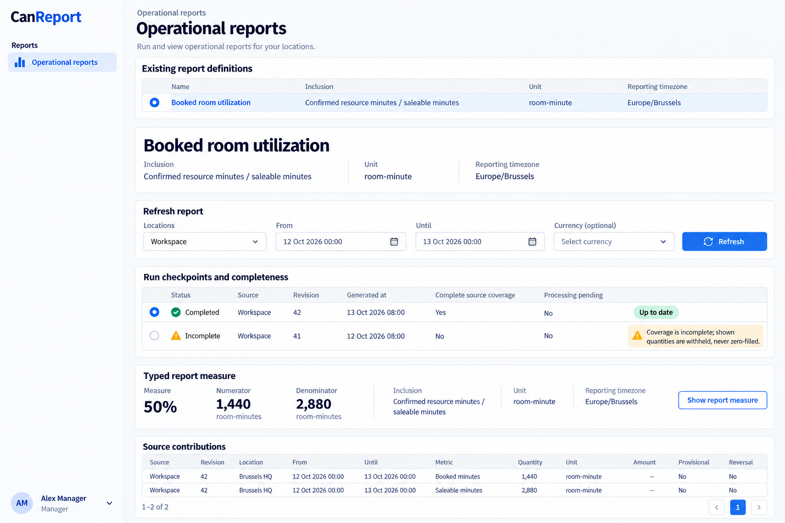

[1 active desktop reference and coverage notes](apps/CanReport/playwright/references/README.md) · [Exact prompts](apps/CanReport/playwright/references/prompts.md) · [Authored source](apps/CanReport/CanReport.can) · [Requirements](apps/CanReport/CanReport.md)

## CanShift

[2 active desktop references and coverage notes](apps/CanShift/playwright/references/README.md) · [Exact prompts](apps/CanShift/playwright/references/prompts.md) · [Authored source](apps/CanShift/CanShift.can) · [Requirements](apps/CanShift/CanShift.md)

## CanStats

[1 active desktop reference and coverage notes](apps/CanStats/playwright/references/README.md) · [Exact prompts](apps/CanStats/playwright/references/prompts.md) · [Authored source](apps/CanStats/CanStats.can) · [Requirements](apps/CanStats/CanStats.md)

## CanStock

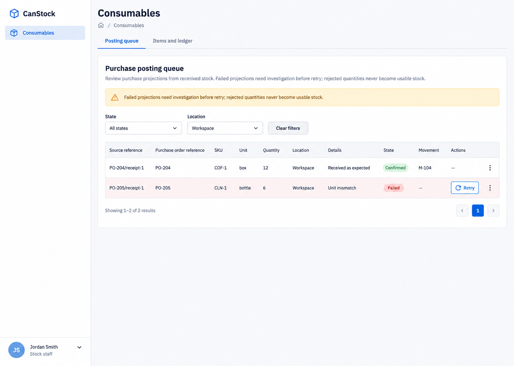

[2 active desktop references and coverage notes](apps/CanStock/playwright/references/README.md) · [Exact prompts](apps/CanStock/playwright/references/prompts.md) · [Authored source](apps/CanStock/CanStock.can) · [Requirements](apps/CanStock/CanStock.md)

## CanSuccess

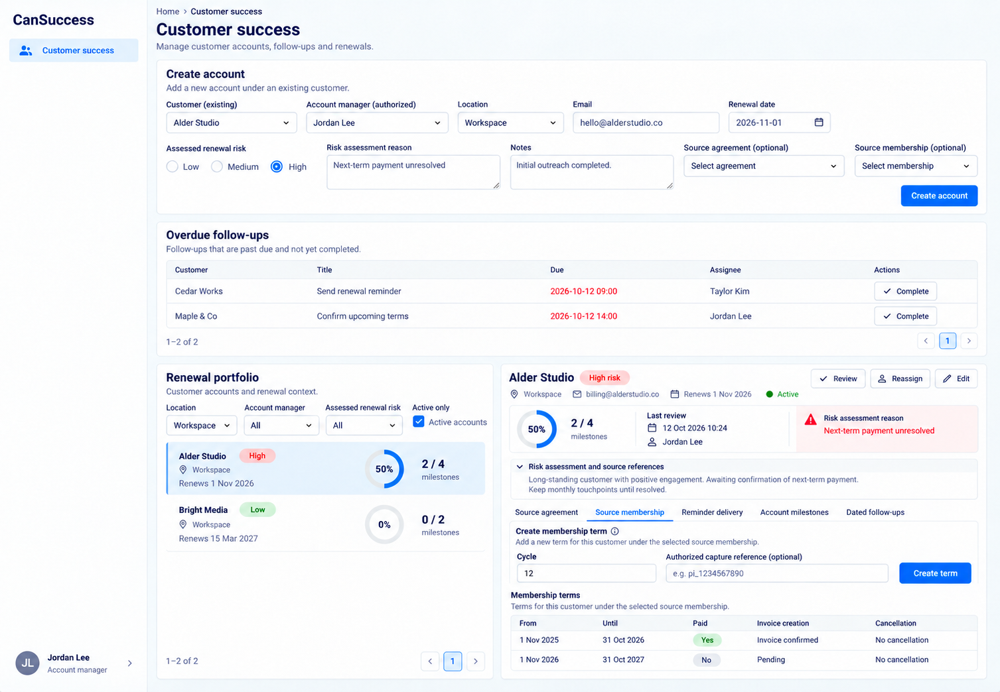

[1 active desktop reference and coverage notes](apps/CanSuccess/playwright/references/README.md) · [Exact prompts](apps/CanSuccess/playwright/references/prompts.md) · [Authored source](apps/CanSuccess/CanSuccess.can) · [Requirements](apps/CanSuccess/CanSuccess.md)

## CanSync

[1 active desktop reference and coverage notes](apps/CanSync/playwright/references/README.md) · [Exact prompts](apps/CanSync/playwright/references/prompts.md) · [Authored source](apps/CanSync/CanSync.can) · [Requirements](apps/CanSync/CanSync.md)

## CanTable

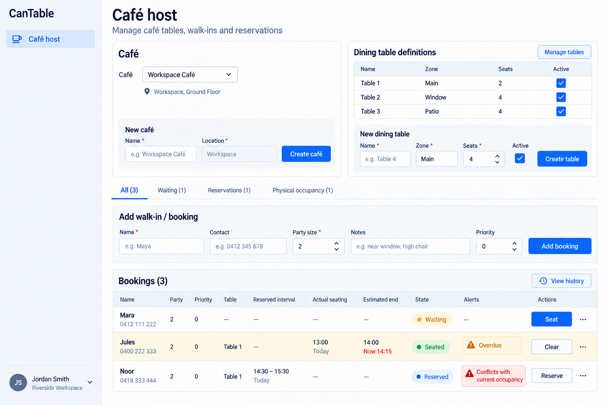

[1 active desktop reference and coverage notes](apps/CanTable/playwright/references/README.md) · [Exact prompts](apps/CanTable/playwright/references/prompts.md) · [Authored source](apps/CanTable/CanTable.can) · [Requirements](apps/CanTable/CanTable.md)

## CanTime

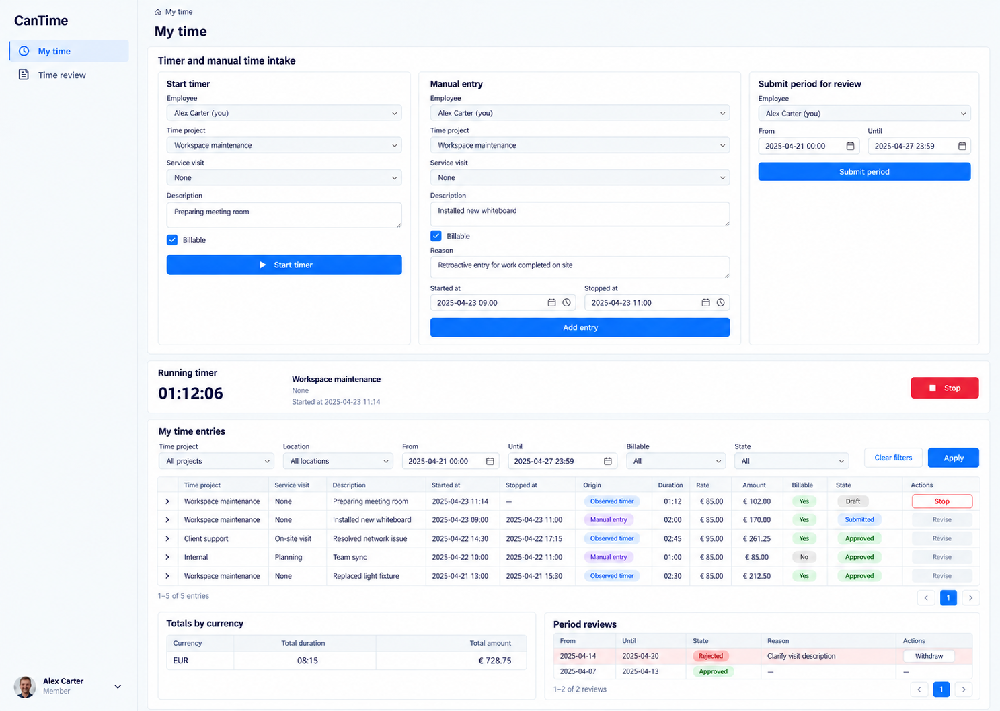

[2 active desktop references and coverage notes](apps/CanTime/playwright/references/README.md) · [Exact prompts](apps/CanTime/playwright/references/prompts.md) · [Authored source](apps/CanTime/CanTime.can) · [Requirements](apps/CanTime/CanTime.md)

## CanTrade

[2 active desktop references and coverage notes](apps/CanTrade/playwright/references/README.md) · [Exact prompts](apps/CanTrade/playwright/references/prompts.md) · [Authored source](apps/CanTrade/CanTrade.can) · [Requirements](apps/CanTrade/CanTrade.md)

## CanVolunteer

[3 active desktop references and coverage notes](apps/CanVolunteer/playwright/references/README.md) · [Exact prompts](apps/CanVolunteer/playwright/references/prompts.md) · [Authored source](apps/CanVolunteer/CanVolunteer.can) · [Requirements](apps/CanVolunteer/CanVolunteer.md)

## CanWorkbench

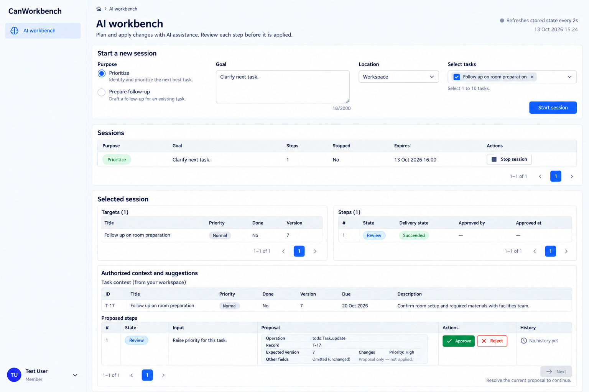

[1 active desktop reference and coverage notes](apps/CanWorkbench/playwright/references/README.md) · [Exact prompts](apps/CanWorkbench/playwright/references/prompts.md) · [Authored source](apps/CanWorkbench/CanWorkbench.can) · [Requirements](apps/CanWorkbench/CanWorkbench.md)
