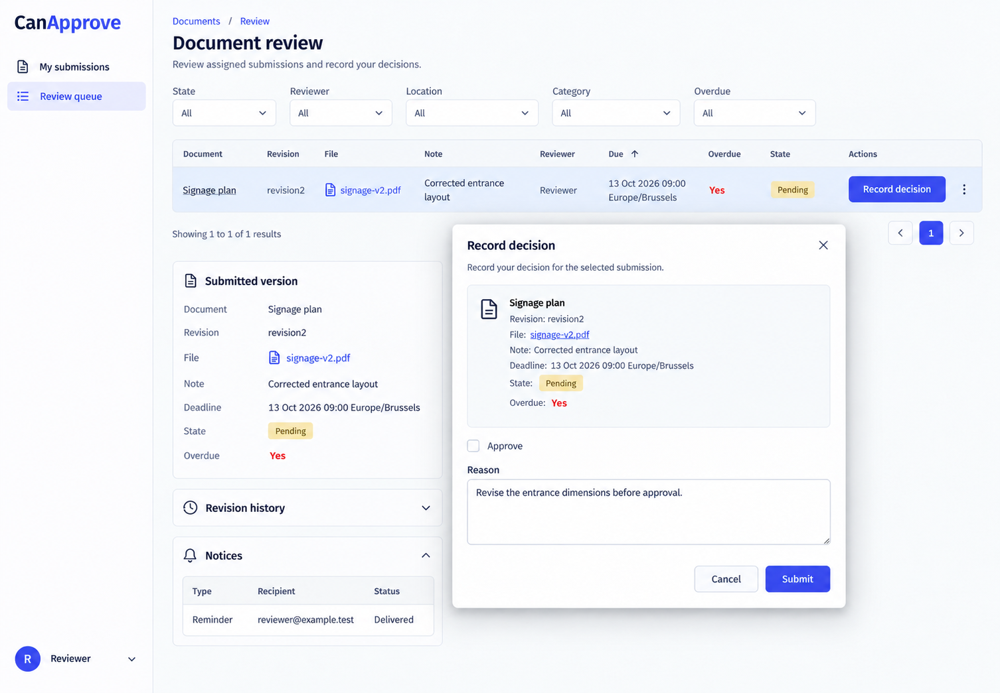
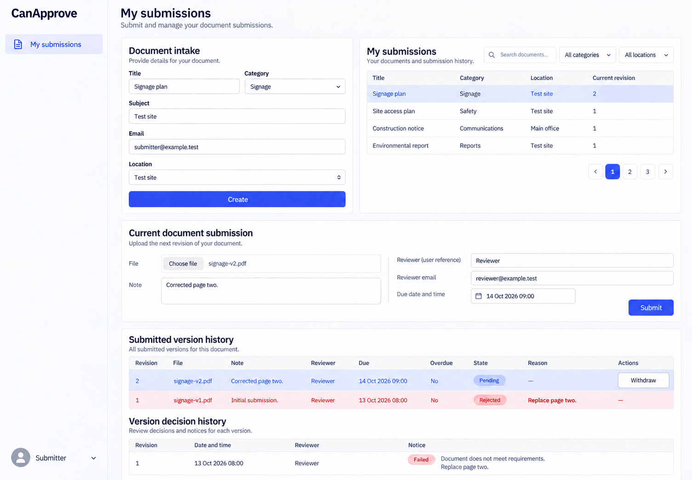

# CanApprove desktop appearance references

2 active desktop references. Latest user direction: **left sidebar, wordmark top left, account bottom left; desktop only**. These are built-in image_gen intended appearance illustrations, generated and inspected on 2026-10-13. They are not runtime screenshots or executed frontend evidence.

Authority: [CanApprove.can](../../CanApprove.can), [companion requirements](../../CanApprove.md), [shared shell](../../../../../docs/specification/REQUIREMENTS.md#standard-shell-and-personal-configuration) and [workspace context](../../../../WORKSPACE_OPERATOR.md). Owning source controls content, field types, permissions, operations, evaluation order and recovery. Sample records, incidental dates and wording are non-normative.

## Active references

### 01-review-decision-desktop-left

- Route: `/documents/review`.
- State/audience: assigned reviewer, decision modal.
- Viewport: desktop landscape; raster 1506 × 1045 pixels (an illustration, not measured browser CSS pixels).
- Visual expectations: canonical left navigation and bottom-left account; readable neutral daisyUI surfaces, restrained indigo actions, distinct captioned states, complete source-defined forms and preserved authorized record context.
- Known omissions: Eligible reviewer candidate lists, coordinator reassignment dialog, complete notice columns and runtime conflict/draft-preservation states are not exhaustively pictured. The review image abbreviates the page heading; canonical title remains Review queue.
- Exact requests: [primary/final shell request](01-review-decision-desktop-left.prompt.md); any focused corrections are retained in [prompts.md](prompts.md).

### 02-own-versions-desktop-left

- Route: `/documents`.
- State/audience: own submitter, retained rejection.
- Viewport: desktop landscape; raster 1505 × 1045 pixels (an illustration, not measured browser CSS pixels).
- Visual expectations: canonical left navigation and bottom-left account; readable neutral daisyUI surfaces, restrained indigo actions, distinct captioned states, complete source-defined forms and preserved authorized record context.
- Known omissions: Eligible reviewer candidate lists, coordinator reassignment dialog, complete notice columns and runtime conflict/draft-preservation states are not exhaustively pictured. The review image abbreviates the page heading; canonical title remains Review queue.
- Exact requests: [primary/final shell request](02-own-versions-desktop-left.prompt.md); any focused corrections are retained in [prompts.md](prompts.md).

## Presentation refinement

Refined ApproveWorkspace style prompt to keep exact file, revision, deadline and reason together and separate immutable context from the decision form. The inspected review reference made this concrete grouping clearer; no new controls or authority were added. Shared-shell comments now say left-sidebar. No business declarations, permissions, operations, API contracts, runtime implementation or tests were changed for these illustrations.

## Verification and scope

Every active PNG was inspected for desktop framing, left navigation, bottom-left account, readable hierarchy and material source discrepancies. Focused revisions addressed concrete defects. Files were copied into this folder immediately after generation. Small visual/text differences are tolerated; source authority is never derived from incidental image details. Changed style strings were directly inspected; runtime behavior, accessibility interactions, uploads, polling, admission, provider outcomes and browser flows were not executed.

[Exact prompt archive](prompts.md) preserves original requests literally, including superseded right-shell requests and withdrawn mobile requests. Task-created intermediate PNGs and mobile PNGs are excluded from this final set. Runtime responsiveness remains governed by source/shared contracts.
