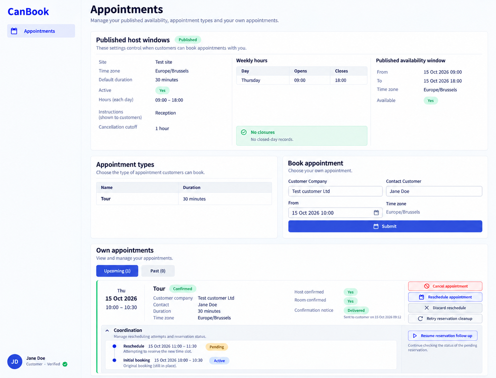
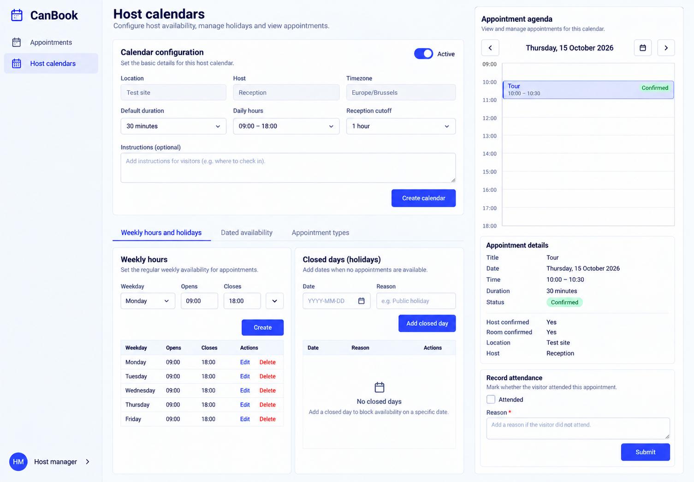

# CanBook desktop appearance references

2 active desktop references. Latest user direction: **left sidebar, wordmark top left, account bottom left; desktop only**. These are built-in image_gen intended appearance illustrations, generated and inspected on 2026-10-13. They are not runtime screenshots or executed frontend evidence.

Authority: [CanBook.can](../../CanBook.can), [companion requirements](../../CanBook.md), [shared shell](../../../../../docs/specification/REQUIREMENTS.md#standard-shell-and-personal-configuration) and [workspace context](../../../../WORKSPACE_OPERATOR.md). Owning source controls content, field types, permissions, operations, evaluation order and recovery. Sample records, incidental dates and wording are non-normative.

## Active references

### 01-appointments-desktop-left

- Route: `/appointments`.
- State/audience: own customer, pending replacement.
- Viewport: desktop landscape; raster 1435 × 1096 pixels (an illustration, not measured browser CSS pixels).
- Visual expectations: canonical left navigation and bottom-left account; readable neutral daisyUI surfaces, restrained indigo actions, distinct captioned states, complete source-defined forms and preserved authorized record context.
- Known omissions: Host intake and current-calendar configuration are visually condensed; follow owning create/update schemas rather than the illustration. Fold radio choices and complete cleanup/attempt fields are abbreviated. No calendar guarantees reservation availability.
- Exact requests: [primary/final shell request](01-appointments-desktop-left.prompt.md); any focused corrections are retained in [prompts.md](prompts.md).

### 02-host-agenda-desktop-left

- Route: `/appointments/hosts`.
- State/audience: host manager, hours and attendance.
- Viewport: desktop landscape; raster 1505 × 1045 pixels (an illustration, not measured browser CSS pixels).
- Visual expectations: canonical left navigation and bottom-left account; readable neutral daisyUI surfaces, restrained indigo actions, distinct captioned states, complete source-defined forms and preserved authorized record context.
- Known omissions: Host intake and current-calendar configuration are visually condensed; follow owning create/update schemas rather than the illustration. Fold radio choices and complete cleanup/attempt fields are abbreviated. No calendar guarantees reservation availability.
- Exact requests: [primary/final shell request](02-host-agenda-desktop-left.prompt.md); any focused corrections are retained in [prompts.md](prompts.md).

## Presentation refinement

Existing Then style guidance already expresses the useful presentation seen in these references; no app-specific style expansion was needed. Shared-shell comments now say left-sidebar. No business declarations, permissions, operations, API contracts, runtime implementation or tests were changed for these illustrations.

## Verification and scope

Every active PNG was inspected for desktop framing, left navigation, bottom-left account, readable hierarchy and material source discrepancies. Focused revisions addressed concrete defects. Files were copied into this folder immediately after generation. Small visual/text differences are tolerated; source authority is never derived from incidental image details. Changed style strings were directly inspected; runtime behavior, accessibility interactions, uploads, polling, admission, provider outcomes and browser flows were not executed.

[Exact prompt archive](prompts.md) preserves original requests literally, including superseded right-shell requests and withdrawn mobile requests. Task-created intermediate PNGs and mobile PNGs are excluded from this final set. Runtime responsiveness remains governed by source/shared contracts.
