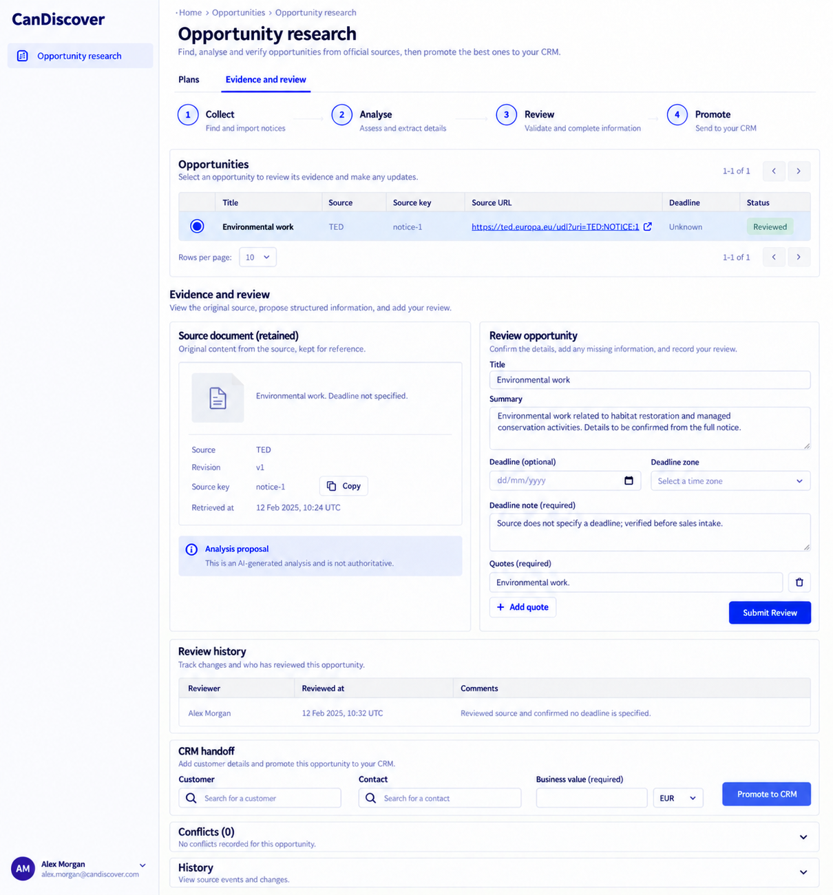
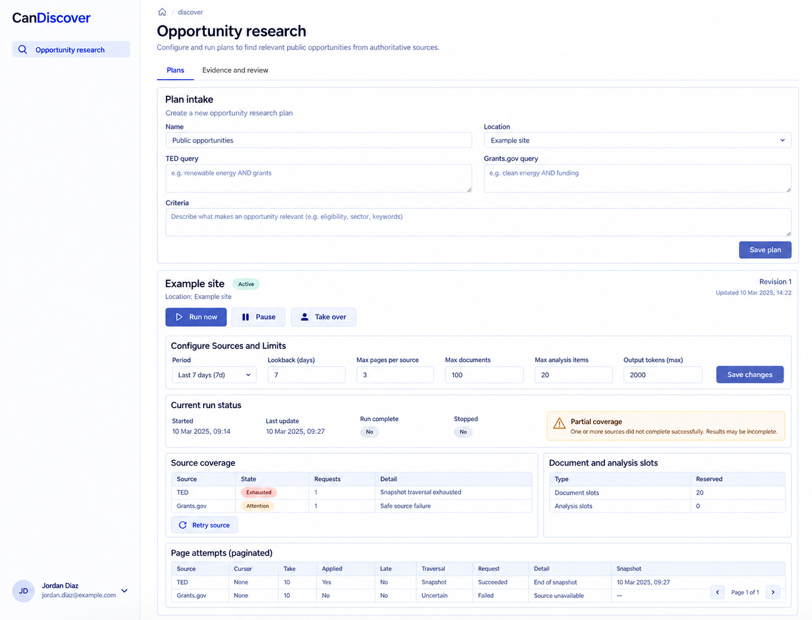

# CanDiscover design references

Generated with the built-in image_gen tool on 2026-10-13. These are **design references, not browser captures or implemented behavior**. [CanDiscover.can](../../CanDiscover.can) and [CanDiscover.md](../../CanDiscover.md) remain authoritative over image text, omissions, control choices and synthetic values. Exact generation/edit prompts are in [prompts.md](prompts.md).

The accepted reference set is desktop-only. The shared shell uses left-side navigation, wordmark at the top left and account at the bottom left. Earlier right-shell prompts and withdrawn mobile prompts are preserved literally in prompts.md as historical provenance. The runtime responsive overlay contract is unchanged; no mobile screenshot is part of this deliverable. Links still derive from current owner grants, declaration order and composition; an image is not a second navigation schema.

## 01-evidence-review-desktop

Route: `/discover`. State: Evidence and review, researcher/reviewer/salesperson. Viewport intent: desktop (~1440×1100 CSS pixels); the tool chooses actual raster dimensions, recorded below after inspection.

Expected: Retained source text alongside corrected review and CRM intake; quotes and business value required.

## 02-plans-coverage-desktop

Route: `/discover`. State: Plans tab, incomplete coverage. Viewport intent: desktop (~1440×1100 CSS pixels); the tool chooses actual raster dimensions, recorded below after inspection.

Expected: Separate per-source traversal and partial coverage, grouped source/limit form.

## Scope and limitations

The screenshot does not qualify real TED/Grants.gov adapters or prove completeness. Claims, identity resolution and full nested history may be abbreviated. All visible names, dates, amounts, files and evidence URLs are illustrative. Forms must preserve source-generated remainder, exact field types, requiredness, current version/permissions, validation and localized labels. Canonical shared loading, empty, no-match, unavailable/conflict states and keyboard behavior still apply even when one populated reference omits them. These images establish no browser, accessibility, runtime, provider or business test result.

## Source presentation choice

Adopted balanced source-evidence/review columns, followed by recorded-review CRM handoff; narrow screens retain source-before-decision reading order. This is a focused edit to the existing `$"style prompt"` only. Operations, model declarations, permission checks, API contracts and inline behavior examples are unchanged.

## Accepted raster sizes

| File | PNG pixels |
| --- | --- |
| 01-evidence-review-desktop.png | 1210 × 1300 |
| 02-plans-coverage-desktop.png | 1435 × 1096 |

Inspected each accepted image. The raster preserves desktop page context; it is not a CSS viewport capture.

The Plans reference condenses configuration fields and child paging. Both source-query/criteria fieldsets remain required source controls; reserved slots are not actual usage and a source snapshot is not a global snapshot.
