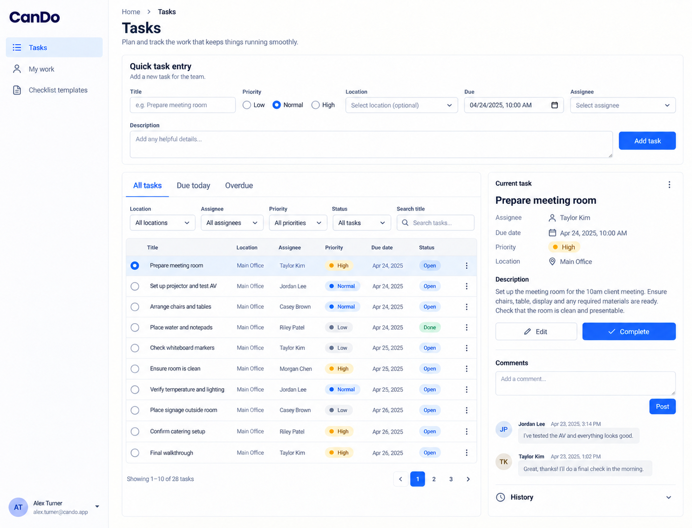
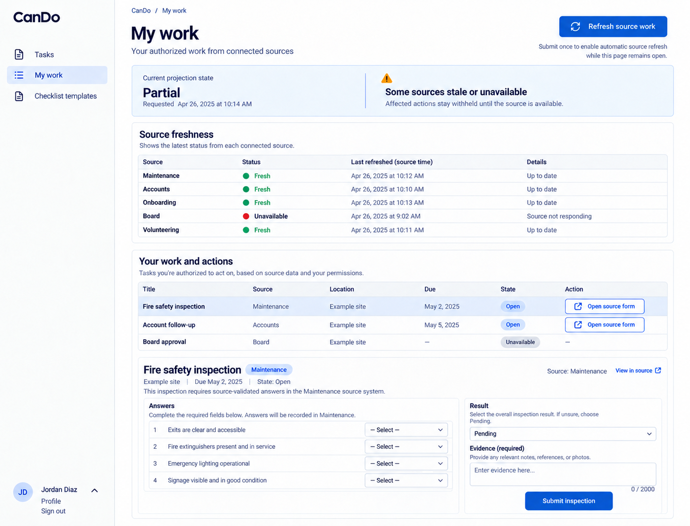

# CanDo design references

Generated with the built-in image_gen tool on 2026-10-13. These are **design references, not browser captures or implemented behavior**. [CanDo.can](../../CanDo.can) and [CanDo.md](../../CanDo.md) remain authoritative over image text, omissions, control choices and synthetic values. Exact generation/edit prompts are in [prompts.md](prompts.md).

The accepted reference set is desktop-only. The shared shell uses left-side navigation, wordmark at the top left and account at the bottom left. Earlier right-shell prompts and withdrawn mobile prompts are preserved literally in prompts.md as historical provenance. The runtime responsive overlay contract is unchanged; no mobile screenshot is part of this deliverable. Links still derive from current owner grants, declaration order and composition; an image is not a second navigation schema.

## 01-tasks-desktop

Route: `/tasks`. State: member task entry and selected open task. Viewport intent: desktop (~1440×1100 CSS pixels); the tool chooses actual raster dimensions, recorded below after inspection.

Expected: Compact entry, task filters/tabs, split current task and attributed comments; only permitted current complete/reopen controls.

## 02-my-work-desktop

Route: `/tasks/my-work`. State: partial source projection. Viewport intent: desktop (~1440×1100 CSS pixels); the tool chooses actual raster dimensions, recorded below after inspection.

Expected: Freshness separate from work state; unavailable sources withhold actions and source actions retain their owning required inputs.

## Scope and limitations

Checklist template authoring is not pictured. Generated task dates/names and rows are synthetic; screenshots do not prove source permissions, stale-edit preservation or refresh behavior. All visible names, dates, amounts, files and evidence URLs are illustrative. Forms must preserve source-generated remainder, exact field types, requiredness, current version/permissions, validation and localized labels. Canonical shared loading, empty, no-match, unavailable/conflict states and keyboard behavior still apply even when one populated reference omits them. These images establish no browser, accessibility, runtime, provider or business test result.

## Source presentation choice

Adopted a compact full-width entry band with current task and comments grouped in existing split detail. This is a focused edit to the existing `$"style prompt"` only. Operations, model declarations, permission checks, API contracts and inline behavior examples are unchanged.

## Accepted raster sizes

| File | PNG pixels |
| --- | --- |
| 01-tasks-desktop.png | 1435 × 1096 |
| 02-my-work-desktop.png | 1435 × 1096 |

Inspected each accepted image. The raster preserves desktop page context; it is not a CSS viewport capture.

Generated source-action control captions, sample answers and default Pending are illustrative. The imported inspection owner supplies its complete schema and rejects invalid/unfinished outcomes; the image does not add choices, evidence limits or a successful result.
