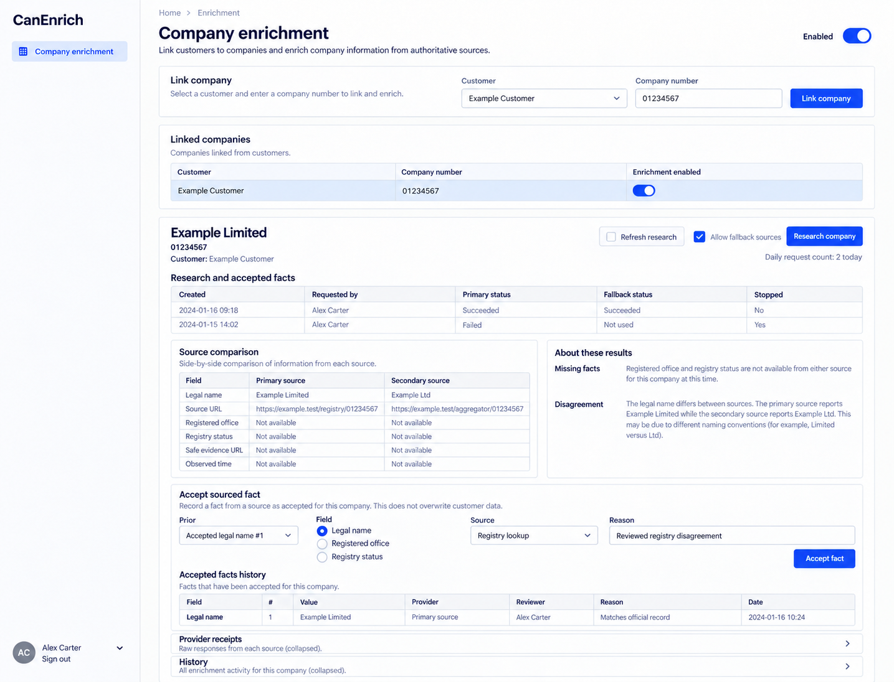

# CanEnrich design references

Generated with the built-in image_gen tool on 2026-10-13. These are **design references, not browser captures or implemented behavior**. [CanEnrich.can](../../CanEnrich.can) and [CanEnrich.md](../../CanEnrich.md) remain authoritative over image text, omissions, control choices and synthetic values. Exact generation/edit prompts are in [prompts.md](prompts.md).

The accepted reference set is desktop-only. The shared shell uses left-side navigation, wordmark at the top left and account at the bottom left. Earlier right-shell prompts and withdrawn mobile prompts are preserved literally in prompts.md as historical provenance. The runtime responsive overlay contract is unchanged; no mobile screenshot is part of this deliverable. Links still derive from current owner grants, declaration order and composition; an image is not a second navigation schema.

## 01-company-review-desktop

Route: `/enrichment`. State: human review of conflicting registry facts. Viewport intent: desktop (~1440×1100 CSS pixels); the tool chooses actual raster dimensions, recorded below after inspection.

Expected: Primary/secondary facts aligned with provenance, exact lookup/prior selection and reason; accepted history separate from incoming facts.

## Scope and limitations

One image covers the sole declared page and essential fact-acceptance form. Fallback consent dialog, stopped/unknown recovery and full receipt/history are not expanded. All visible names, dates, amounts, files and evidence URLs are illustrative. Forms must preserve source-generated remainder, exact field types, requiredness, current version/permissions, validation and localized labels. Canonical shared loading, empty, no-match, unavailable/conflict states and keyboard behavior still apply even when one populated reference omits them. These images establish no browser, accessibility, runtime, provider or business test result.

## Source presentation choice

Adopted aligned primary/secondary fact fields, adjacent source links/observation times and acceptance immediately after comparison. This is a focused edit to the existing `$"style prompt"` only. Operations, model declarations, permission checks, API contracts and inline behavior examples are unchanged.

## Accepted raster sizes

| File | PNG pixels |
| --- | --- |
| 01-company-review-desktop.png | 1435 × 1096 |

Inspected each accepted image. The raster preserves desktop page context; it is not a CSS viewport capture.
