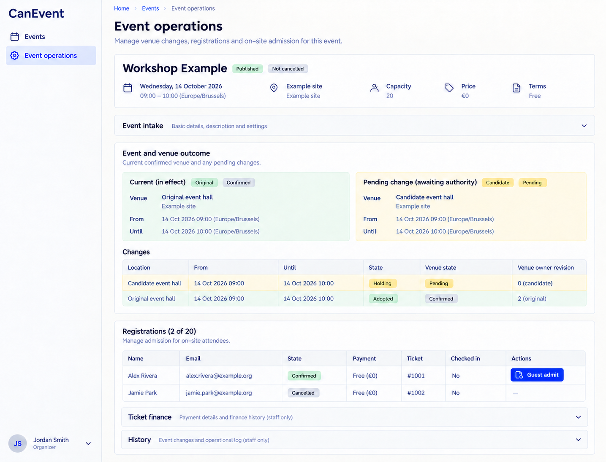

# CanEvent design references

Generated with the built-in image_gen tool on 2026-10-13. These are **design references, not browser captures or implemented behavior**. [CanEvent.can](../../CanEvent.can) and [CanEvent.md](../../CanEvent.md) remain authoritative over image text, omissions, control choices and synthetic values. Exact generation/edit prompts are in [prompts.md](prompts.md).

The accepted reference set is desktop-only. The shared shell uses left-side navigation, wordmark at the top left and account at the bottom left. Earlier right-shell prompts and withdrawn mobile prompts are preserved literally in prompts.md as historical provenance. The runtime responsive overlay contract is unchanged; no mobile screenshot is part of this deliverable. Links still derive from current owner grants, declaration order and composition; an image is not a second navigation schema.

## 01-event-registration-desktop

Route: `/events`. State: authenticated self registration and own free ticket. Viewport intent: desktop (~1440×1100 CSS pixels); the tool chooses actual raster dimensions, recorded below after inspection.

Expected: Terms at decision time, verified own identity, separate ticket/payment/admission/notice outcomes.

## 02-event-operations-desktop

Route: `/events/work`. State: organizer and admission staff, pending venue change. Viewport intent: desktop (~1440×1100 CSS pixels); the tool chooses actual raster dimensions, recorded below after inspection.

Expected: Retained confirmed venue beside unconfirmed candidate; only confirmed eligible ticket admits.

## Scope and limitations

Public available-seat progress is deliberately omitted: the source itself records an unresolved field/row permission gap. CanInvoice's composed pages and full refund/reconciliation forms are not pictured; no payment or venue success follows image decoration. All visible names, dates, amounts, files and evidence URLs are illustrative. Forms must preserve source-generated remainder, exact field types, requiredness, current version/permissions, validation and localized labels. Canonical shared loading, empty, no-match, unavailable/conflict states and keyboard behavior still apply even when one populated reference omits them. These images establish no browser, accessibility, runtime, provider or business test result.

## Source presentation choice

The existing source style prompt already expresses this presentation adequately; no source change was made.

## Accepted raster sizes

| File | PNG pixels |
| --- | --- |
| 01-event-registration-desktop.png | 1435 × 1096 |
| 02-event-operations-desktop.png | 1435 × 1096 |

Inspected each accepted image. The raster preserves desktop page context; it is not a CSS viewport capture.
