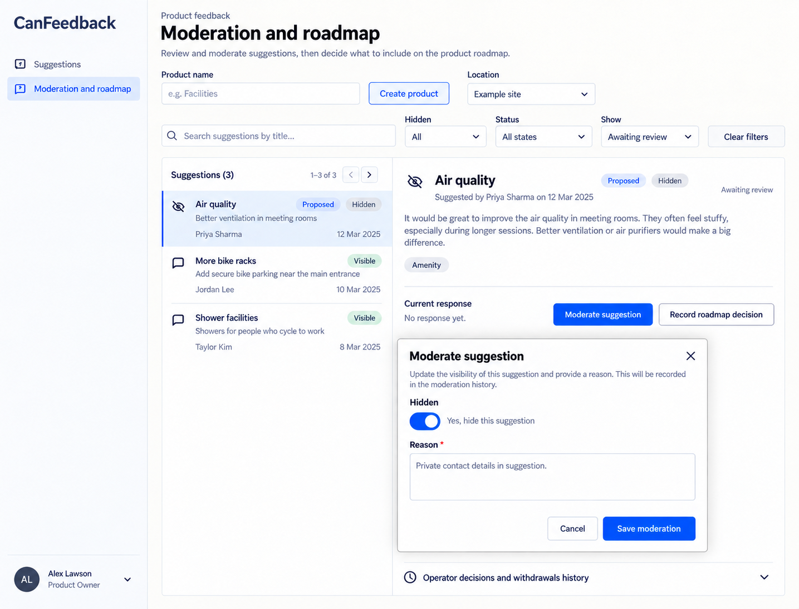

# CanFeedback design references

Generated with the built-in image_gen tool on 2026-10-13. These are **design references, not browser captures or implemented behavior**. [CanFeedback.can](../../CanFeedback.can) and [CanFeedback.md](../../CanFeedback.md) remain authoritative over image text, omissions, control choices and synthetic values. Exact generation/edit prompts are in [prompts.md](prompts.md).

The accepted reference set is desktop-only. The shared shell uses left-side navigation, wordmark at the top left and account at the bottom left. Earlier right-shell prompts and withdrawn mobile prompts are preserved literally in prompts.md as historical provenance. The runtime responsive overlay contract is unchanged; no mobile screenshot is part of this deliverable. Links still derive from current owner grants, declaration order and composition; an image is not a second navigation schema.

## 01-suggestions-desktop

Route: `/feedback`. State: authenticated contributor. Viewport intent: desktop (~1440×1100 CSS pixels); the tool chooses actual raster dimensions, recorded below after inspection.

Expected: Published roadmap and aggregate votes, own pending submission, staff response, owned vote controls and urgent private support route.

## 02-moderation-desktop

Route: `/feedback/moderation`. State: owning product owner. Viewport intent: desktop (~1440×1100 CSS pixels); the tool chooses actual raster dimensions, recorded below after inspection.

Expected: Moderation reason and hidden flag separate from roadmap state; immutable author and decision/withdrawal history.

## Scope and limitations

Vote totals are synthetic examples of a declared aggregate, not adoption metrics. A drawn dropdown/disabled state cannot replace typed input, cooldown or actual owner checks; no private voter disclosure. All visible names, dates, amounts, files and evidence URLs are illustrative. Forms must preserve source-generated remainder, exact field types, requiredness, current version/permissions, validation and localized labels. Canonical shared loading, empty, no-match, unavailable/conflict states and keyboard behavior still apply even when one populated reference omits them. These images establish no browser, accessibility, runtime, provider or business test result.

## Source presentation choice

The existing source style prompt already expresses this presentation adequately; no source change was made.

## Accepted raster sizes

| File | PNG pixels |
| --- | --- |
| 01-suggestions-desktop.png | 1435 × 1096 |
| 02-moderation-desktop.png | 1435 × 1096 |

Inspected each accepted image. The raster preserves desktop page context; it is not a CSS viewport capture.
