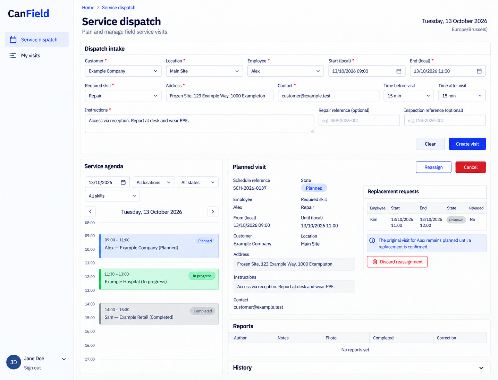
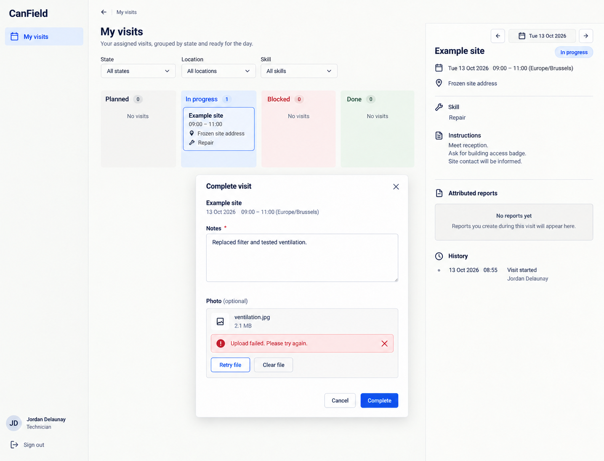

# CanField design references

Generated with the built-in image_gen tool on 2026-10-13. These are **design references, not browser captures or implemented behavior**. [CanField.can](../../CanField.can) and [CanField.md](../../CanField.md) remain authoritative over image text, omissions, control choices and synthetic values. Exact generation/edit prompts are in [prompts.md](prompts.md).

The accepted reference set is desktop-only. The shared shell uses left-side navigation, wordmark at the top left and account at the bottom left. Earlier right-shell prompts and withdrawn mobile prompts are preserved literally in prompts.md as historical provenance. The runtime responsive overlay contract is unchanged; no mobile screenshot is part of this deliverable. Links still derive from current owner grants, declaration order and composition; an image is not a second navigation schema.

## 01-dispatch-desktop

Route: `/dispatch`. State: dispatcher agenda and unknown replacement. Viewport intent: desktop (~1440×1100 CSS pixels); the tool chooses actual raster dimensions, recorded below after inspection.

Expected: Dated calendar, frozen visit instructions, retained commitment versus replacement; current contact is an email.

## 02-my-visit-desktop

Route: `/dispatch/mine`. State: assigned technician, notes retained after optional photo failure. Viewport intent: desktop (~1440×1100 CSS pixels); the tool chooses actual raster dimensions, recorded below after inspection.

Expected: Address/time/action before history, linear notes/file completion form, left shared navigation.

## Scope and limitations

Inspection-specific answers and source repair verification are not expanded. No screenshot proves schedule authority, reassignment fencing or successful photo completion; finished visit never releases room downtime. All visible names, dates, amounts, files and evidence URLs are illustrative. Forms must preserve source-generated remainder, exact field types, requiredness, current version/permissions, validation and localized labels. Canonical shared loading, empty, no-match, unavailable/conflict states and keyboard behavior still apply even when one populated reference omits them. These images establish no browser, accessibility, runtime, provider or business test result.

## Source presentation choice

The existing source style prompt already expresses this presentation adequately; no source change was made.

## Accepted raster sizes

| File | PNG pixels |
| --- | --- |
| 01-dispatch-desktop.png | 1435 × 1096 |
| 02-my-visit-desktop.png | 1435 × 1096 |

Inspected each accepted image. The raster preserves desktop page context; it is not a CSS viewport capture.
