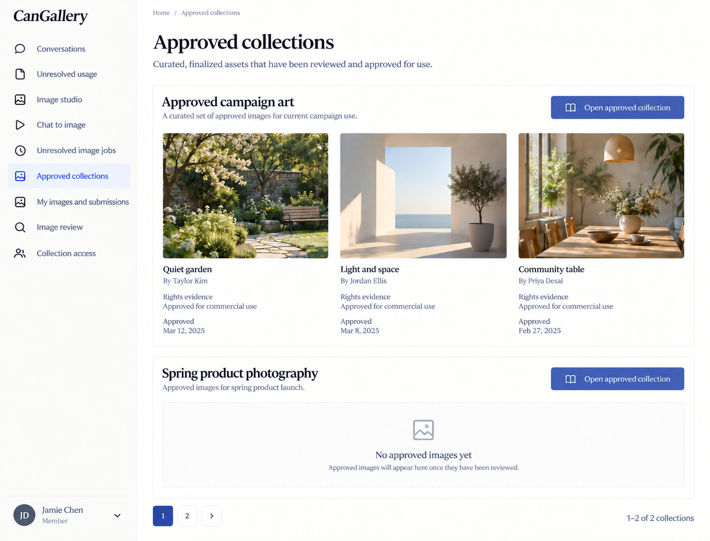
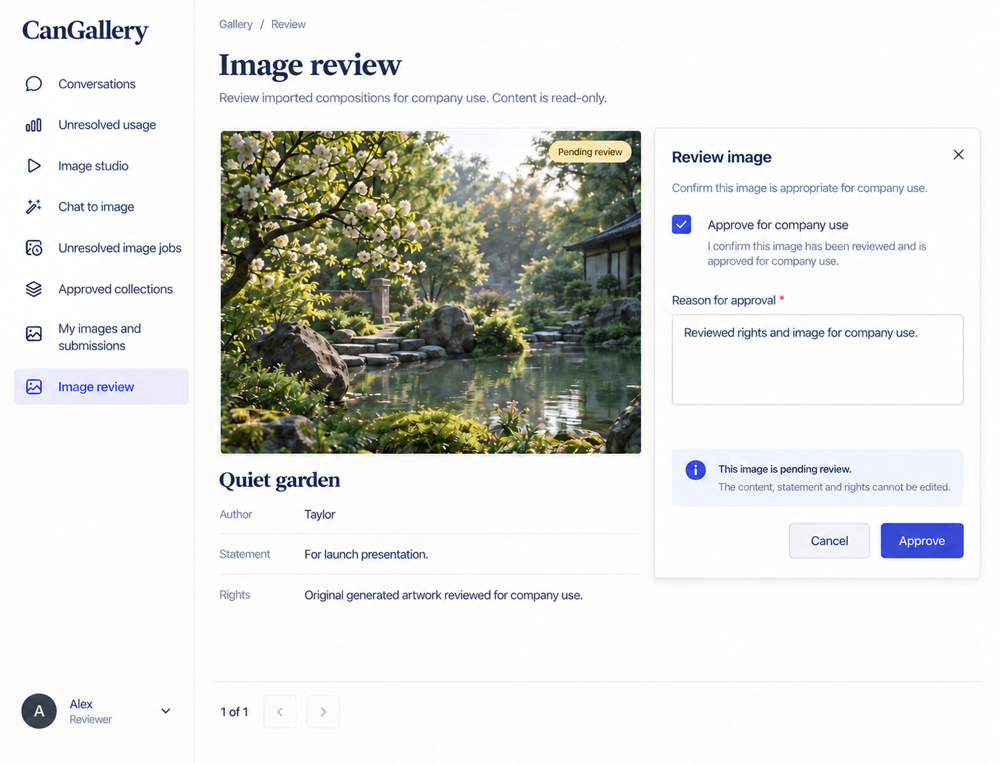

# CanGallery design references

Generated with the built-in image_gen tool on 2026-10-13. These are **design references, not browser captures or implemented behavior**. [CanGallery.can](../../CanGallery.can) and [CanGallery.md](../../CanGallery.md) remain authoritative over image text, omissions, control choices and synthetic values. Exact generation/edit prompts are in [prompts.md](prompts.md).

The accepted reference set is desktop-only. The shared shell uses left-side navigation, wordmark at the top left and account at the bottom left. Earlier right-shell prompts and withdrawn mobile prompts are preserved literally in prompts.md as historical provenance. The runtime responsive overlay contract is unchanged; no mobile screenshot is part of this deliverable. Links still derive from current owner grants, declaration order and composition; an image is not a second navigation schema.

## 01-approved-collection-desktop

Route: `/gallery`. State: member/curator/reviewer with approved collection access. Viewport intent: desktop (~1440×1100 CSS pixels); the tool chooses actual raster dimensions, recorded below after inspection.

Expected: Consistent image previews and readable title/author/rights/date captions; only approved disclosed assets.

## 02-image-review-desktop

Route: `/gallery/review`. State: independent reviewer, pending submitted image. Viewport intent: desktop (~1440×1100 CSS pixels); the tool chooses actual raster dimensions, recorded below after inspection.

Expected: Frozen image and intended-use/rights evidence with approval checkbox and required reason.

## Scope and limitations

Creative artwork is synthetic. Submit and collection-access pages are not separately pictured; exact composed menu visibility derives from the imported owning pages (Image studio, not Creative runs). Image review never exposes original prompt/conversation/run. All visible names, dates, amounts, files and evidence URLs are illustrative. Forms must preserve source-generated remainder, exact field types, requiredness, current version/permissions, validation and localized labels. Canonical shared loading, empty, no-match, unavailable/conflict states and keyboard behavior still apply even when one populated reference omits them. These images establish no browser, accessibility, runtime, provider or business test result.

## Source presentation choice

Adopted stable preview areas with readable wrapping captions for title, author, rights and approval date. This is a focused edit to the existing `$"style prompt"` only. Operations, model declarations, permission checks, API contracts and inline behavior examples are unchanged.

The explanatory shared-shell comment was aligned from right to left after the latest user direction.

## Accepted raster sizes

| File | PNG pixels |
| --- | --- |
| 01-approved-collection-desktop.png | 1437 × 1095 |
| 02-image-review-desktop.png | 1435 × 1096 |

Inspected each accepted image. The raster preserves desktop page context; it is not a CSS viewport capture.
