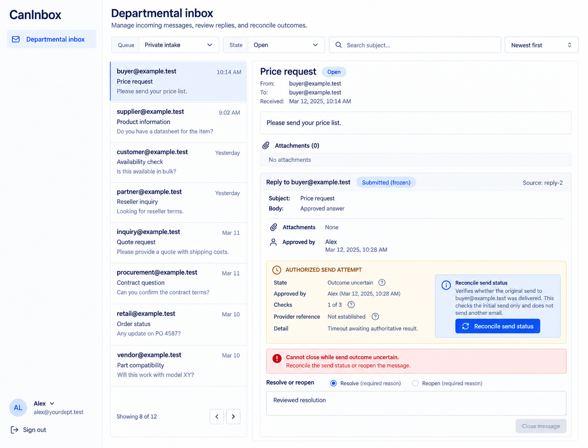

# CanInbox design references

Generated with the built-in image_gen tool on 2026-10-13. These are **design references, not browser captures or implemented behavior**. [CanInbox.can](../../CanInbox.can) and [CanInbox.md](../../CanInbox.md) remain authoritative over image text, omissions, control choices and synthetic values. Exact generation/edit prompts are in [prompts.md](prompts.md).

The accepted reference set is desktop-only. The shared shell uses left-side navigation, wordmark at the top left and account at the bottom left. Earlier right-shell prompts and withdrawn mobile prompts are preserved literally in prompts.md as historical provenance. The runtime responsive overlay contract is unchanged; no mobile screenshot is part of this deliverable. Links still derive from current owner grants, declaration order and composition; an image is not a second navigation schema.

## 01-departmental-inbox-desktop

Route: `/inbox`. State: private queue staff, assessment and manual transfer. Viewport intent: desktop (~1440×1100 CSS pixels); the tool chooses actual raster dimensions, recorded below after inspection.

Expected: Full retained message, complete route/urgency probabilities, explicit staff reason and exact saved reply.

## 02-uncertain-reply-desktop

Route: `/inbox`. State: authorized staff, unknown frozen send. Viewport intent: desktop (~1440×1100 CSS pixels); the tool chooses actual raster dimensions, recorded below after inspection.

Expected: Exact approved payload and original send identity; reconcile without resend until authoritative non-send.

## Scope and limitations

Inbox settings is not pictured. Complete specifications/usage, files and all attempt histories may be abbreviated. Prediction never grants queue access; provider acceptance never proves recipient delivery. All visible names, dates, amounts, files and evidence URLs are illustrative. Forms must preserve source-generated remainder, exact field types, requiredness, current version/permissions, validation and localized labels. Canonical shared loading, empty, no-match, unavailable/conflict states and keyboard behavior still apply even when one populated reference omits them. These images establish no browser, accessibility, runtime, provider or business test result.

## Source presentation choice

The existing source style prompt already expresses this presentation adequately; only the explanatory shared-shell comment was aligned from right to left; executable source is unchanged.

## Accepted raster sizes

| File | PNG pixels |
| --- | --- |
| 01-departmental-inbox-desktop.png | 1435 × 1096 |
| 02-uncertain-reply-desktop.png | 1435 × 1096 |

Inspected each accepted image. The raster preserves desktop page context; it is not a CSS viewport capture.

In the uncertain-send reference, generated reconciliation copy using “delivered” must be interpreted through the source contract: observe exact provider acceptance or authoritative non-send, never recipient delivery/read. The closed/open input remains the source boolean, irrespective of the drawn radio styling.
