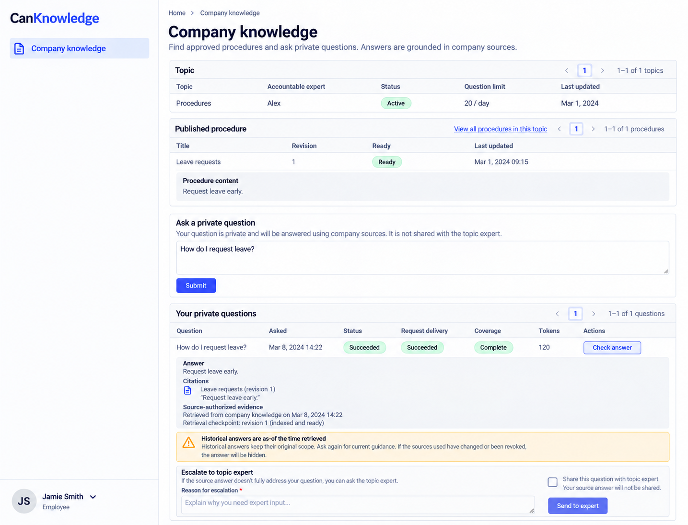
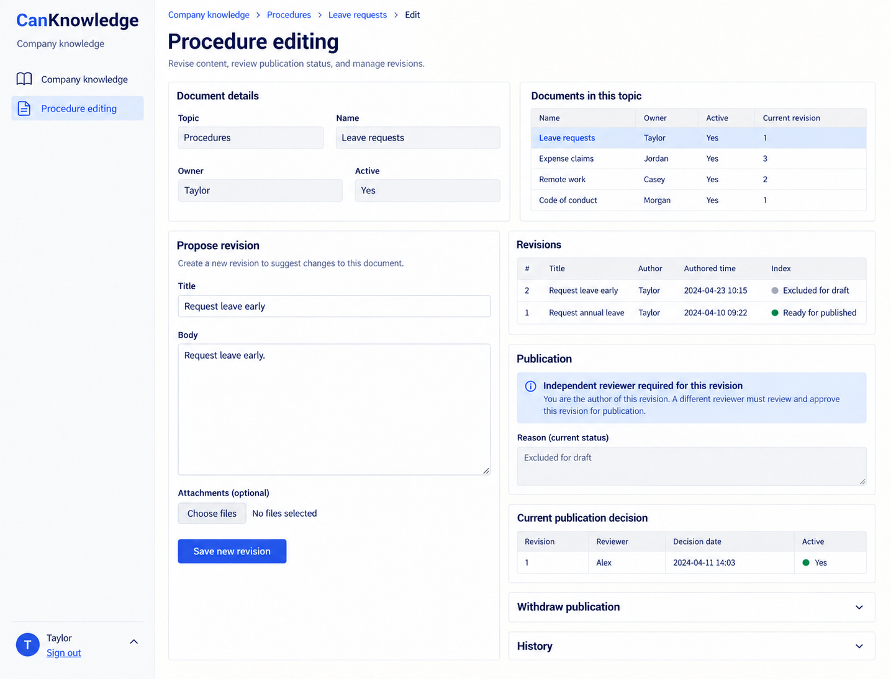

# CanKnowledge design references

Generated with the built-in image_gen tool on 2026-10-13. These are **design references, not browser captures or implemented behavior**. [CanKnowledge.can](../../CanKnowledge.can) and [CanKnowledge.md](../../CanKnowledge.md) remain authoritative over image text, omissions, control choices and synthetic values. Exact generation/edit prompts are in [prompts.md](prompts.md).

The accepted reference set is desktop-only. The shared shell uses left-side navigation, wordmark at the top left and account at the bottom left. Earlier right-shell prompts and withdrawn mobile prompts are preserved literally in prompts.md as historical provenance. The runtime responsive overlay contract is unchanged; no mobile screenshot is part of this deliverable. Links still derive from current owner grants, declaration order and composition; an image is not a second navigation schema.

## 01-private-sourced-answer-desktop

Route: `/knowledge`. State: authorized reader, private answer with sources. Viewport intent: desktop (~1440×1100 CSS pixels); the tool chooses actual raster dimensions, recorded below after inspection.

Expected: Read-only publication/index readiness, exact source citation and coverage, historical warning; expert sharing explicitly consented.

## 02-procedure-editor-desktop

Route: `/knowledge/editor`. State: author-owned immutable revision; independent publication history. Viewport intent: desktop (~1440×1100 CSS pixels); the tool chooses actual raster dimensions, recorded below after inspection.

Expected: Draft revision distinct from current publication/index; the author cannot approve their own draft, and the prior independent publication remains attributed.

## Scope and limitations

Expert and manager pages are not separately pictured. The protected answer/citation renderer, revocation, rechecks and historical scope remain runtime contracts; the raster is not index/model proof. All visible names, dates, amounts, files and evidence URLs are illustrative. Forms must preserve source-generated remainder, exact field types, requiredness, current version/permissions, validation and localized labels. Canonical shared loading, empty, no-match, unavailable/conflict states and keyboard behavior still apply even when one populated reference omits them. These images establish no browser, accessibility, runtime, provider or business test result.

## Source presentation choice

The existing source style prompt already expresses this presentation adequately; only the explanatory shared-shell comment was aligned from right to left; executable source is unchanged.

## Accepted raster sizes

| File | PNG pixels |
| --- | --- |
| 01-private-sourced-answer-desktop.png | 1435 × 1096 |
| 02-procedure-editor-desktop.png | 1435 × 1096 |

Inspected each accepted image. The raster preserves desktop page context; it is not a CSS viewport capture.
