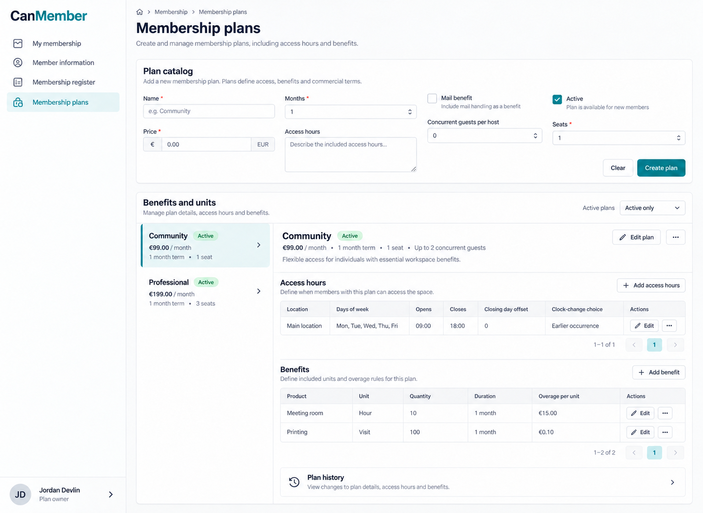
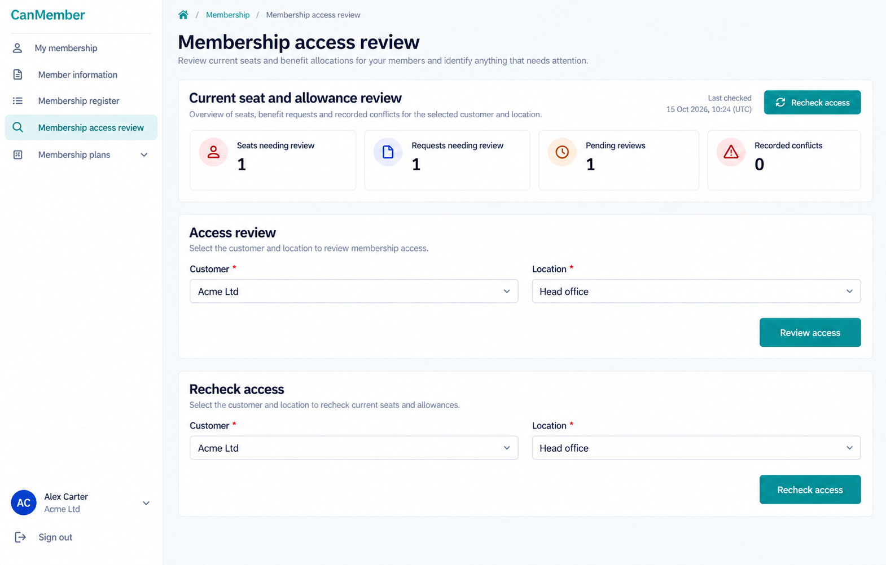
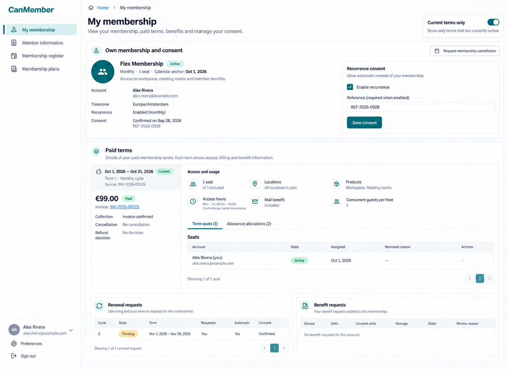
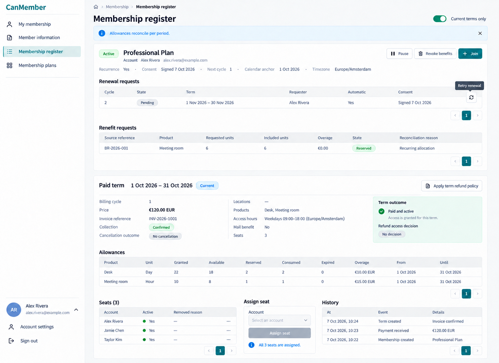
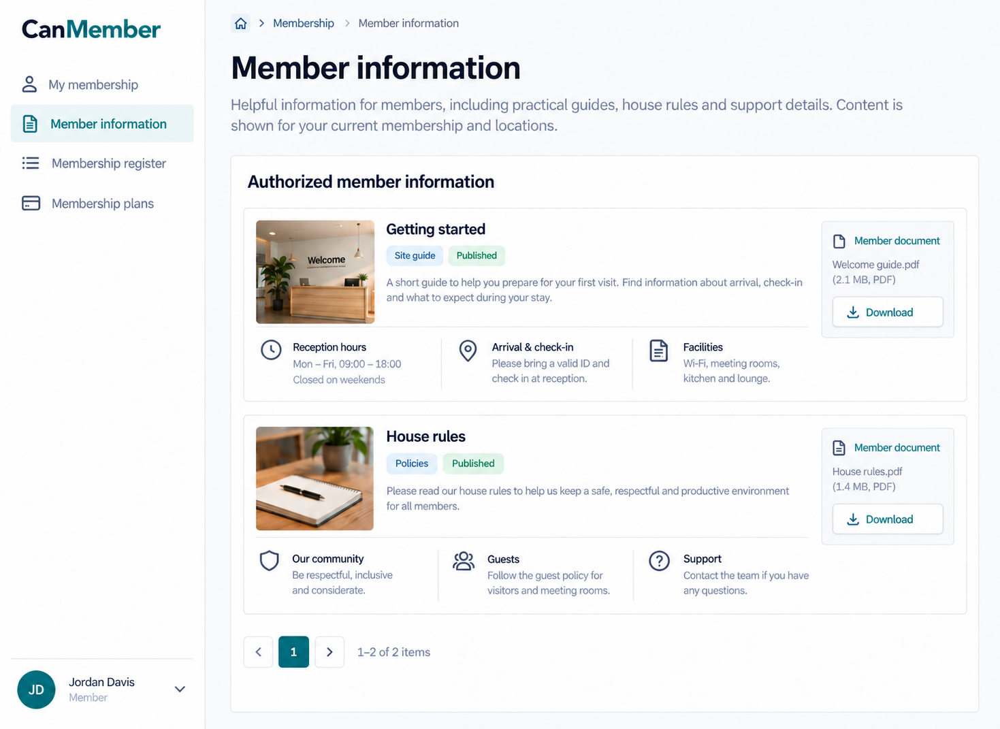

# CanMember desktop design references

These are intended desktop design references generated with the built-in image_gen tool, not runtime screenshots or executed workflow evidence. Sources are the owning .can and companion requirements, the workspace operator context and canonical shared shell. Latest user direction governs: collapsible LEFT sidebar, top-left wordmark and bottom-left account/sign-in. Runtime responsive behavior remains required, but this reference set is desktop-only.

Viewport intent is approximately 1440×1050 landscape (some source prompts use1440×1100); generator raster dimensions may differ. Content is one actual page surface with no device/browser frame or collage. Long nested forms, other tabs and closed dialogs may continue beyond the pictured viewport.

Names, locations, dates, amounts, text and files are illustrative placeholders, not configured operator records or a coherent cross-image fixture dataset. Use configured locations/currency/timezone and real returned owner states. Required markers, counters, extra helper prose, filter selections, freshness timestamps and account-menu labels are not additional schema, limits, permissions or actions. Canonical forms retain every unbound argument, validation and conflict outcome even where a compact reference omits controls. Navigation is the admitted projection of current source pages; displayed combinations are illustrative combined authorized contexts, not grants inferred from an avatar or role caption. Contextual/token destinations never become static menu entries.

Every generated output was visually inspected; focused corrections addressed observed shell, source-state, arithmetic, required-input and public-auth mistakes. No code, runtime, parser, browser journey or business invariant was executed. These PNGs guide layout and hierarchy; owning source remains authoritative for behavior, field/record guards, evaluation order and connected outcomes. Do not encode incidental generator mistakes into implementation or source style prompts.

## Retained coverage

5 desktop PNGs; no count exception is needed. The set covers the distinct reading, intake, authoring, queue, evidence or agenda layouts listed below. Shared components and state variants do not each receive another PNG.

### Membership plans

- Route: `/membership/plans`.
- State: Plan-owner catalog with benefit units and published access-hour rows.
- Viewport: desktop landscape, approximately 1440×1050 intent; no mobile target.
- Expectations: retain the selected source hierarchy, complete canonical forms, distinct outcome labels, readable evidence and current actor admission; use the shared left shell.

### Membership access review

- Route: `/membership/access-review`.
- State: Authorized customer/location access-review and recheck forms with the four declared returned counts.
- Viewport: desktop landscape, approximately 1440×1050 intent; no mobile target.
- Expectations: retain the selected source hierarchy, complete canonical forms, distinct outcome labels, readable evidence and current actor admission; use the shared left shell.

### My membership

- Route: `/membership/mine`.
- State: Own consent, current paid-term snapshot, seats and renewal/benefit context.
- Viewport: desktop landscape, approximately 1440×1050 intent; no mobile target.
- Expectations: retain the selected source hierarchy, complete canonical forms, distinct outcome labels, readable evidence and current actor admission; use the shared left shell.

### Membership register

- Route: `/membership/register`.
- State: Manager register with paid term, allowance ledger and full-capacity seat assignment disabled.
- Viewport: desktop landscape, approximately 1440×1050 intent; no mobile target.
- Expectations: retain the selected source hierarchy, complete canonical forms, distinct outcome labels, readable evidence and current actor admission; use the shared left shell.

### Member information

- Route: `/membership/content`.
- State: Authorized member information and document reading.
- Viewport: desktop landscape, approximately 1440×1050 intent; no mobile target.
- Expectations: retain the selected source hierarchy, complete canonical forms, distinct outcome labels, readable evidence and current actor admission; use the shared left shell.

## Grouped and unpictured routes/states

- `/companies/{Customer.id}/membership-access`: Contextual company variant; reuse the access-review form/result layout and the paid-seat rows shown in My membership/Register. Its company guard and exact scoped signals remain its own source. No separate company-page image.
- `/membership/content/edit`: Authoring counterpart to Member information using the existing labeled text/file intake and list/edit patterns. Its exact article editor and document-upload state are unpictured. No implied removal of these controls.

## Known limitations and inspection outcome

Some reference navigation omits eligible content/access entries in particular visual contexts; runtime derives all current admitted destinations. The access-review target retains a decorative last-checked label/shortcut; only the two owning forms and four returned counts define its contract. The plan form and secondary term/allowance dialogs remain complete generated forms even when not all fields fit the pictured intake. Consent and seat/refund/retry controls retain their exact grants and source-state conditions.

## Source style and provenance

Then style prompts were retained: their existing shared-shell/default and content guidance already expresses the pictured card/form/table hierarchy. No visual mistake was promoted into executable behavior, permissions or an API. Explanatory shared-shell comments were aligned with the user's left-sidebar direction where present. Exact generation and final edit requests are in [prompts.md](prompts.md); earlier right-sidebar requests are explicitly superseded. Existing `*.prompt.md` files are preserved historical inputs, not active targets. Task-created mobile output was withdrawn; this gallery displays every retained PNG in this app's reference folder.

