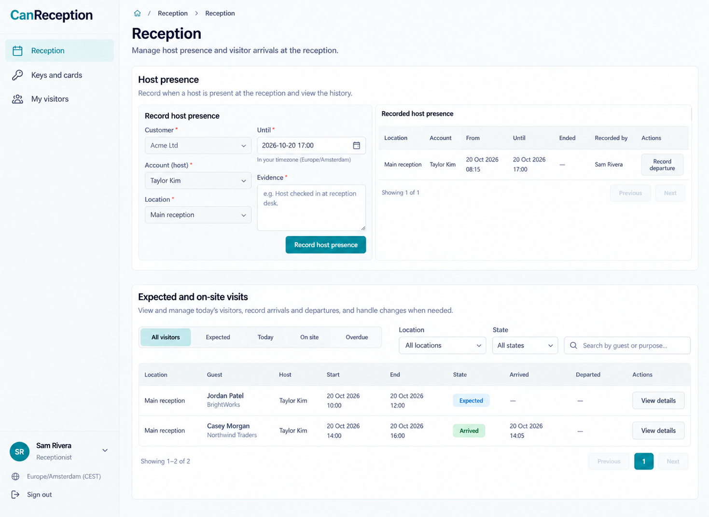
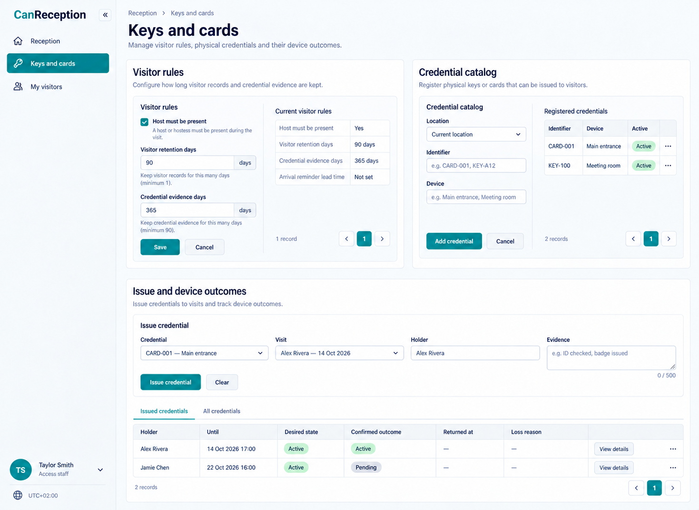
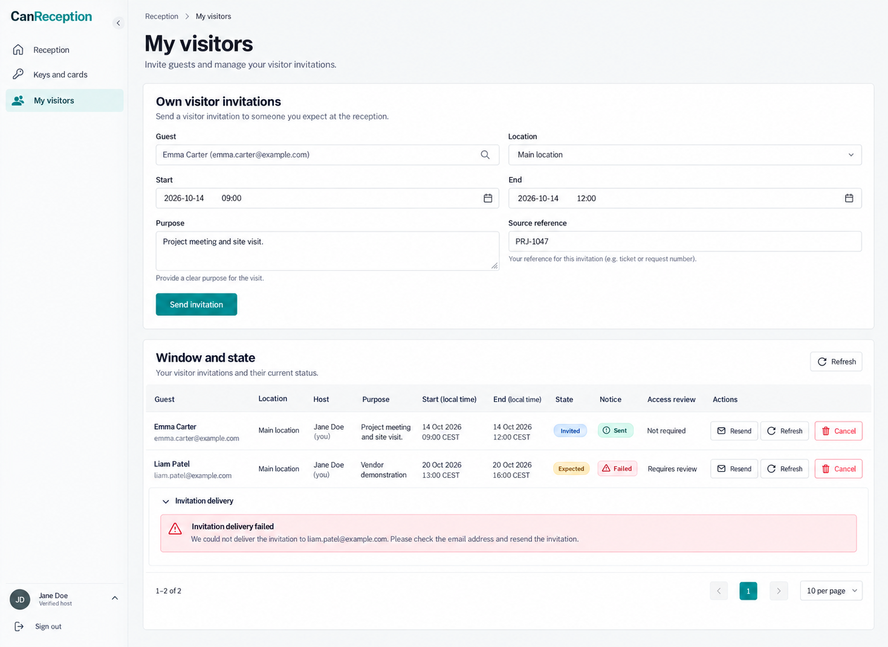

# CanReception desktop design references

These are intended desktop design references generated with the built-in image_gen tool, not runtime screenshots or executed workflow evidence. Sources are the owning .can and companion requirements, the workspace operator context and canonical shared shell. Latest user direction governs: collapsible LEFT sidebar, top-left wordmark and bottom-left account/sign-in. Runtime responsive behavior remains required, but this reference set is desktop-only.

Viewport intent is approximately 1440×1050 landscape (some source prompts use1440×1100); generator raster dimensions may differ. Content is one actual page surface with no device/browser frame or collage. Long nested forms, other tabs and closed dialogs may continue beyond the pictured viewport.

Names, locations, dates, amounts, text and files are illustrative placeholders, not configured operator records or a coherent cross-image fixture dataset. Use configured locations/currency/timezone and real returned owner states. Required markers, counters, extra helper prose, filter selections, freshness timestamps and account-menu labels are not additional schema, limits, permissions or actions. Canonical forms retain every unbound argument, validation and conflict outcome even where a compact reference omits controls. Navigation is the admitted projection of current source pages; displayed combinations are illustrative combined authorized contexts, not grants inferred from an avatar or role caption. Contextual/token destinations never become static menu entries.

Every generated output was visually inspected; focused corrections addressed observed shell, source-state, arithmetic, required-input and public-auth mistakes. No code, runtime, parser, browser journey or business invariant was executed. These PNGs guide layout and hierarchy; owning source remains authoritative for behavior, field/record guards, evaluation order and connected outcomes. Do not encode incidental generator mistakes into implementation or source style prompts.

## Retained coverage

3 desktop PNGs; no count exception is needed. The set covers the distinct reading, intake, authoring, queue, evidence or agenda layouts listed below. Shared components and state variants do not each receive another PNG.

### Reception

- Route: `/reception`.
- State: Reception host-presence intake and expected/arrived visitor queue.
- Viewport: desktop landscape, approximately 1440×1050 intent; no mobile target.
- Expectations: retain the selected source hierarchy, complete canonical forms, distinct outcome labels, readable evidence and current actor admission; use the shared left shell.

### Keys and cards

- Route: `/reception/credentials`.
- State: Credential catalog, visitor-rule intake and desired/device-confirmed outcomes.
- Viewport: desktop landscape, approximately 1440×1050 intent; no mobile target.
- Expectations: retain the selected source hierarchy, complete canonical forms, distinct outcome labels, readable evidence and current actor admission; use the shared left shell.

### My visitors

- Route: `/reception/mine`.
- State: Own visitor invitation intake with delivery and access-review context.
- Viewport: desktop landscape, approximately 1440×1050 intent; no mobile target.
- Expectations: retain the selected source hierarchy, complete canonical forms, distinct outcome labels, readable evidence and current actor admission; use the shared left shell.

## Grouped and unpictured routes/states

- `/reception/access-review`: Review/recheck form and returned-signal pattern matches the shared form/result layout pictured for CanMember access review; visitor/credential rows reuse this app's pictured surfaces. Its exact review screen is unpictured.
- `/companies/{Customer.id}/reception-access`: Contextual company-bound review variant of the same form/table patterns. Exact company context and company administrator guard are unpictured and remain source-owned.

## Known limitations and inspection outcome

Access review and company contextual routes are grouped below, not independently pictured. Role captions/avatar names do not create receptionist/access/company grants. Visitor admission, present host, paid term/booking evidence, device confirmations and overdue/return/lost/revocation states remain independent. Owner location controls and complete invitation parameters remain generated even where secondary forms are compact.

## Source style and provenance

Then style prompts were retained: their existing shared-shell/default and content guidance already expresses the pictured card/form/table hierarchy. No visual mistake was promoted into executable behavior, permissions or an API. Explanatory shared-shell comments were aligned with the user's left-sidebar direction where present. Exact generation and final edit requests are in [prompts.md](prompts.md); earlier right-sidebar requests are explicitly superseded. Existing `*.prompt.md` files are preserved historical inputs, not active targets. Task-created mobile output was withdrawn; this gallery displays every retained PNG in this app's reference folder.

