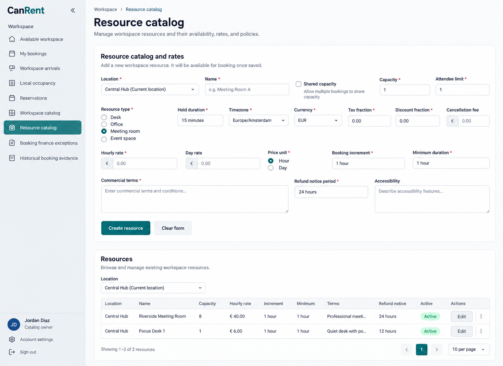
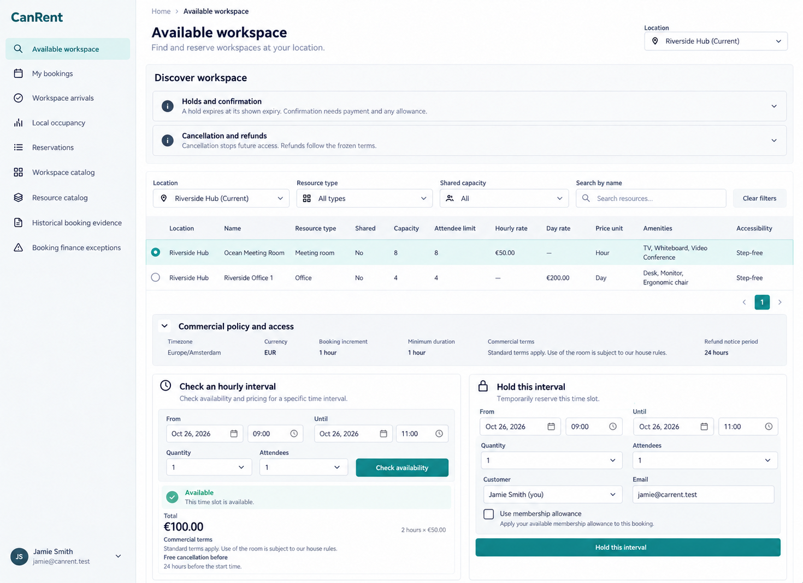
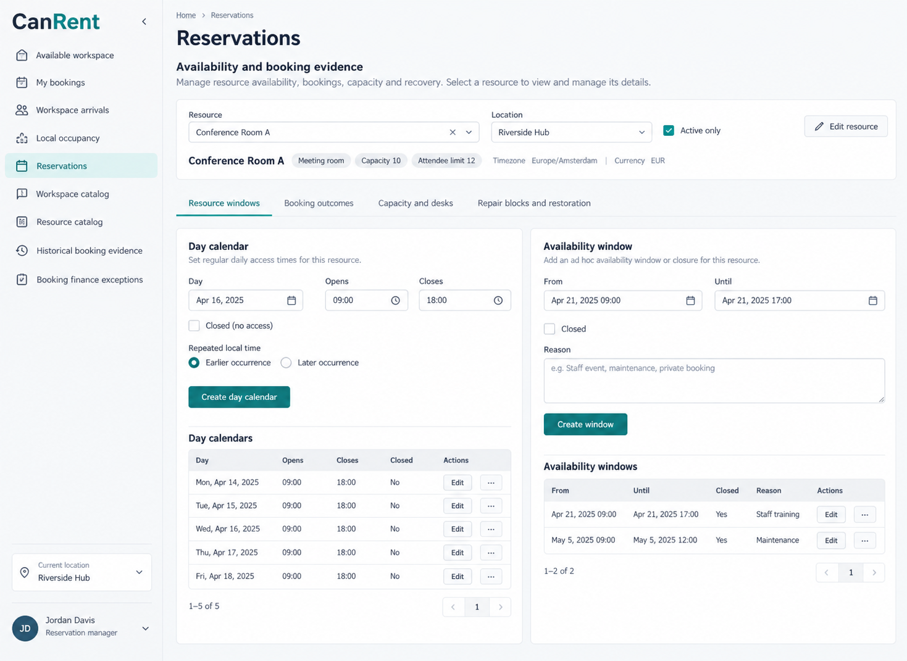
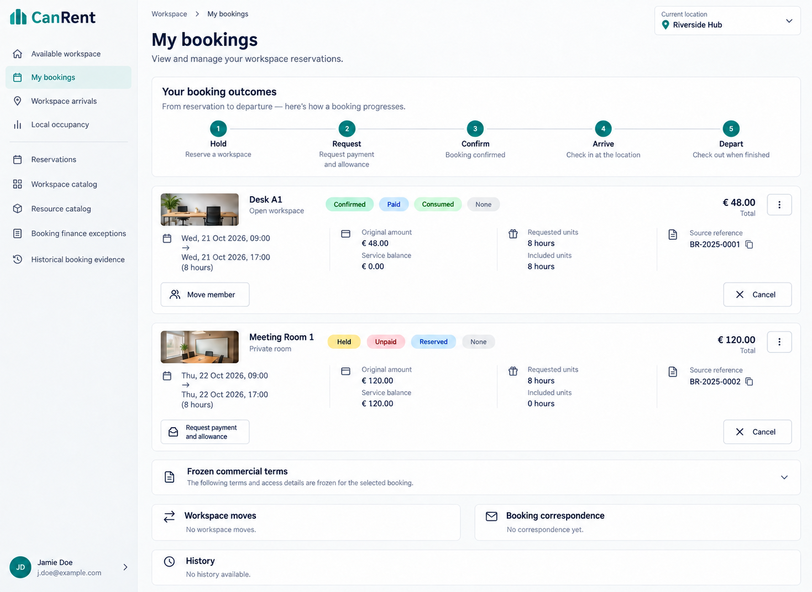
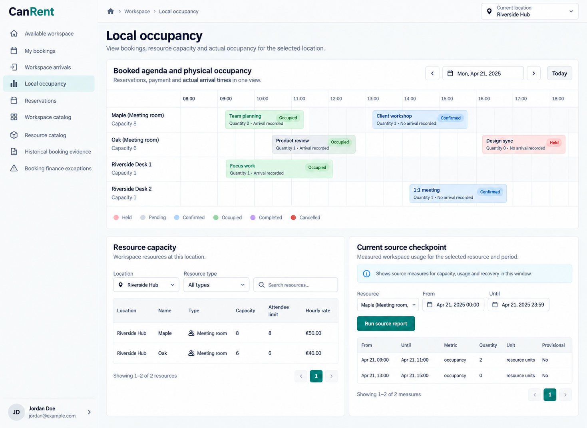

# CanRent desktop design references

These are intended desktop design references generated with the built-in image_gen tool, not runtime screenshots or executed workflow evidence. Sources are the owning .can and companion requirements, the workspace operator context and canonical shared shell. Latest user direction governs: collapsible LEFT sidebar, top-left wordmark and bottom-left account/sign-in. Runtime responsive behavior remains required, but this reference set is desktop-only.

Viewport intent is approximately 1440×1050 landscape (some source prompts use1440×1100); generator raster dimensions may differ. Content is one actual page surface with no device/browser frame or collage. Long nested forms, other tabs and closed dialogs may continue beyond the pictured viewport.

Names, locations, dates, amounts, text and files are illustrative placeholders, not configured operator records or a coherent cross-image fixture dataset. Use configured locations/currency/timezone and real returned owner states. Required markers, counters, extra helper prose, filter selections, freshness timestamps and account-menu labels are not additional schema, limits, permissions or actions. Canonical forms retain every unbound argument, validation and conflict outcome even where a compact reference omits controls. Navigation is the admitted projection of current source pages; displayed combinations are illustrative combined authorized contexts, not grants inferred from an avatar or role caption. Contextual/token destinations never become static menu entries.

Every generated output was visually inspected; focused corrections addressed observed shell, source-state, arithmetic, required-input and public-auth mistakes. No code, runtime, parser, browser journey or business invariant was executed. These PNGs guide layout and hierarchy; owning source remains authoritative for behavior, field/record guards, evaluation order and connected outcomes. Do not encode incidental generator mistakes into implementation or source style prompts.

## Retained coverage

5 desktop PNGs; no count exception is needed. The set covers the distinct reading, intake, authoring, queue, evidence or agenda layouts listed below. Shared components and state variants do not each receive another PNG.

### Resource catalog

- Route: `/workspace/resources`.
- State: Resource catalog intake with rates, capacity, commercial terms and published-resource rows.
- Viewport: desktop landscape, approximately 1440×1050 intent; no mobile target.
- Expectations: retain the selected source hierarchy, complete canonical forms, distinct outcome labels, readable evidence and current actor admission; use the shared left shell.

### Available workspace

- Route: `/workspace`.
- State: Workspace discovery with independent interval-check and hold forms.
- Viewport: desktop landscape, approximately 1440×1050 intent; no mobile target.
- Expectations: retain the selected source hierarchy, complete canonical forms, distinct outcome labels, readable evidence and current actor admission; use the shared left shell.

### Reservations

- Route: `/workspace/reservations`.
- State: Reservation-manager resource windows and day calendars; other booking/capacity/repair tabs retained.
- Viewport: desktop landscape, approximately 1440×1050 intent; no mobile target.
- Expectations: retain the selected source hierarchy, complete canonical forms, distinct outcome labels, readable evidence and current actor admission; use the shared left shell.

### My bookings

- Route: `/workspace/my-bookings`.
- State: Own held and confirmed booking outcomes with state-appropriate action examples.
- Viewport: desktop landscape, approximately 1440×1050 intent; no mobile target.
- Expectations: retain the selected source hierarchy, complete canonical forms, distinct outcome labels, readable evidence and current actor admission; use the shared left shell.

### Local occupancy

- Route: `/workspace/occupancy`.
- State: Booked agenda, recorded occupancy, resource capacity and authorized owner report context.
- Viewport: desktop landscape, approximately 1440×1050 intent; no mobile target.
- Expectations: retain the selected source hierarchy, complete canonical forms, distinct outcome labels, readable evidence and current actor admission; use the shared left shell.

## Grouped and unpictured routes/states

- `/workspace/catalog`: Location authoring uses the resource-catalog intake/table pattern plus reservation-calendar date/hour controls. Exact weekly hours, closures, date overrides and arrival-information sections are unpictured.
- `/workspace/history`: Historical import, retained artifact/attestation and scoped alias mapping are unpictured. Reuse readable evidence tables, file controls and generated edit/history patterns; never make immutable historical facts editable.
- `/workspace/refund-review`: Finance exception/refund forms are unpictured. Reuse My bookings outcome sections and labeled amount/reason dialogs under the finance guard; no screenshot proves collection or refund.
- `/workspace/arrivals`: Operational arrival/departure queue is unpictured. Reuse the booking row/agenda hierarchy from My bookings and Local occupancy, preserving authoritative payment/allowance and current-arrival checks.

## Known limitations and inspection outcome

Sample resource photos, labels and report units are illustrative, not new catalog fields or real measured data. An occupancy event's pictured Quantity0 on the held example must use actual positive Booking.quantity; its no-arrival meaning is separate. Arrival/departure timestamps and owner-returned report metric/unit/provisional values must be preserved. Daily holds, allowance move cleanup, desk assignments, refund recovery and detailed downtime dialogs are unpictured; no image is proof of reservation/payment/access.

## Source style and provenance

Then style prompts were retained: their existing shared-shell/default and content guidance already expresses the pictured card/form/table hierarchy. No visual mistake was promoted into executable behavior, permissions or an API. Explanatory shared-shell comments were aligned with the user's left-sidebar direction where present. Exact generation and final edit requests are in [prompts.md](prompts.md); earlier right-sidebar requests are explicitly superseded. Existing `*.prompt.md` files are preserved historical inputs, not active targets. Task-created mobile output was withdrawn; this gallery displays every retained PNG in this app's reference folder.

