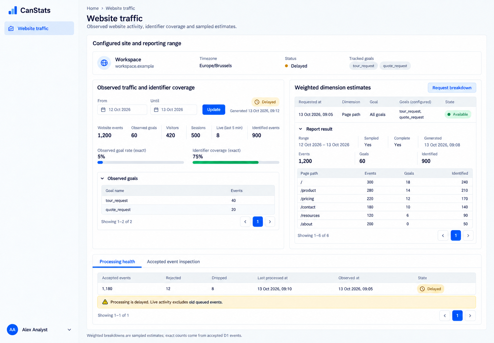

# CanStats intended-design references

Generated UI design targets, not actual screenshots, working frontends or passing E2E tests. Built-in imagegen, 13 October 2026. [Exact prompts](prompts.md); [source](../../CanStats.can); [requirements](../../CanStats.md); [all apps](../../../../UI_REFERENCES.md).

## Comparison contract

Use source requirements and canonical permissions before image details. Treat meaningful differences in layout, hierarchy, source-owned content or controls, readability, responsive behavior and state presentation as visual defects. Ignore harmless antialiasing, tiny spacing, equivalent typography and illustrative data differences. Never copy an image omission, invented control, incorrect caption or sample inconsistency into product requirements.

Preserve loading, empty/no-match, failed, stale, pending/unknown and successful states as separate source-owned outcomes. They are grouped into representative layouts here, not individually exhaustive pixel baselines. Shared left-sidebar shell applies on desktop, with the account menu at the bottom left. This reference set is desktop-only by the user’s latest instruction; runtime responsive requirements remain unchanged.

## 01-traffic-populated-desktop.png

- Page: `/traffic`. State: Analyst; exact accepted-event summary, sampled breakdown and delayed ingestion.
- Viewport intent: Desktop approximately1440×1000 CSS px.
- Important expectations: Readable site/range metadata; separate exact counts/ratios from weighted estimates; preserve sampled and complete labels, identifier coverage and delay notice.
- Known limitations: Generated site status says Delayed, but Site.active is a boolean: show Active/Inactive there and Delayed only for summary/health. The image also retains an earlier health observation timestamp beside later processing; use coherent fresh source timestamps. Sample counts are illustrative. Home breadcrumb is not a new destination. Event inspection and request dialog share established table/form patterns and are not separately pictured.

## Then presentation refinement

The existing `$"..."` style literal was refined after inspecting the images: retain the useful intake/detail hierarchy and aligned evidence described above. These are accepted presentation instructions; data declarations, business rules, operation bindings, admission and inline examples remain intact. Exact dimensions, brand decoration and generator mistakes were not adopted.

Coverage: desktop source page layouts are represented; inactive tabs and equivalent typed dialogs share these patterns. Own-role desktop replacements cover My shifts and volunteer assignments; no mobile references remain active. No Dutch/theme variants or every possible loading/error/empty state are separately pictured. Those requirements remain source-authoritative, and no runtime or screenshot verification is claimed.

Desktop-only revision: mobile PNGs created during this task were withdrawn after the user’s 13 October 2026 instruction. Original pre-task PNGs remain preserved. Earlier right-sidebar prompts are retained as provenance; the final left-sidebar edit prompts supersede shell direction.
