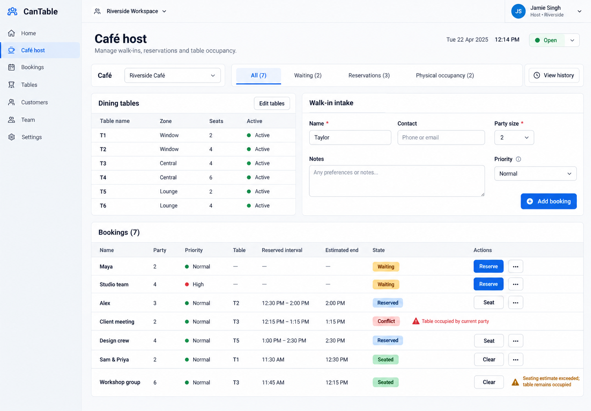

# CanTable UI reference

Intended route: `/cafe`, authenticated host, populated waiting/reservations/physical-occupancy state. The built-in image-generation tool produced this concept before the user moved image work to a separate bot. The exact prompt is saved alongside it.

This image is provisional. Retain its readable hierarchy, party/table/timing emphasis, separated intake, clear controls and overdue/conflict notices. It is not a real screenshot or passing E2E result.

Reference corrections for the next image bot: the source has only Café host as a sidebar page; remove invented Home, Bookings, Tables, Customers, Team and business Settings navigation. Conflict is a separate notice on a reserved booking, not a new Booking state. Priority is an integer in the source, not a new enum. The invented Open toggle is not an app requirement. Sample people, dates and decorative branding are illustrative. Required café/table creation controls and canonical operation behavior remain defined by the source and companion, even where this concept omits them.

Compare meaningfully, allowing harmless font, antialiasing, sample-data and small spacing differences. Do not implement invented image details or copy its omissions. No screenshot comparison has run.
