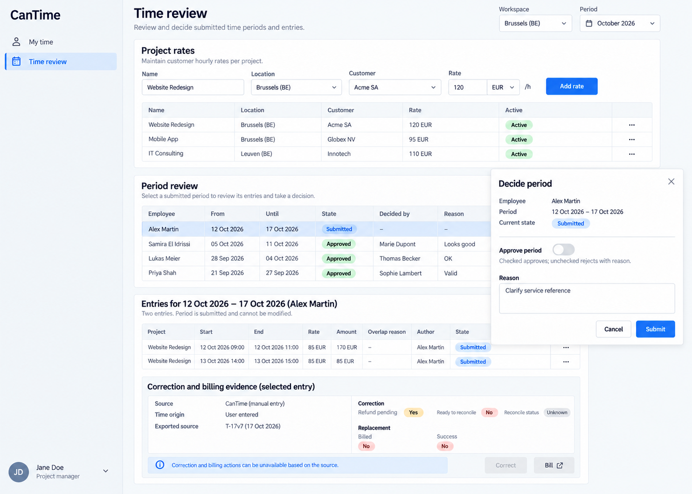

# CanTime intended-design references

Generated UI design targets, not actual screenshots, working frontends or passing E2E tests. Built-in imagegen, 13 October 2026. [Exact prompts](prompts.md); [source](../../CanTime.can); [requirements](../../CanTime.md); [all apps](../../../../UI_REFERENCES.md).

## Comparison contract

Use source requirements and canonical permissions before image details. Treat meaningful differences in layout, hierarchy, source-owned content or controls, readability, responsive behavior and state presentation as visual defects. Ignore harmless antialiasing, tiny spacing, equivalent typography and illustrative data differences. Never copy an image omission, invented control, incorrect caption or sample inconsistency into product requirements.

Preserve loading, empty/no-match, failed, stale, pending/unknown and successful states as separate source-owned outcomes. They are grouped into representative layouts here, not individually exhaustive pixel baselines. Shared left-sidebar shell applies on desktop, with the account menu at the bottom left. This reference set is desktop-only by the user’s latest instruction; runtime responsive requirements remain unchanged.

## 01-own-time-desktop.png

- Page: `/time/mine`. State: Own employee; running timer, manual intake, observed/entered rows and rejected review.
- Viewport intent: Desktop approximately1440×1000 CSS px.
- Important expectations: Distinct start/manual/submit forms above own time; origin, frozen rate, interval and review state remain legible; completed totals exclude running/superseded entries and separate currencies.
- Known limitations: Illustrative elapsed time and totals are not a timer implementation. Complete datetime/service controls and owner permission checks win over incidental sample labels. Full evidence/history is collapsed/abbreviated.

## 02-period-review-desktop.png

- Page: `/time/review`. State: Project manager; frozen submitted period, decision dialog and unresolved correction billing.
- Viewport intent: Desktop approximately1440×1000 CSS px; decision modal open.
- Important expectations: Rates separate from frozen entries; decision uses approval toggle plus reason; source-correlated correction/refund uncertainty cannot imply issued or paid replacement invoice.
- Known limitations: Project/entry/correction tables are partially obscured and not every financial evidence column fits. Missing source fields remain required; sample money is one currency only.

## Then presentation refinement

The existing `$"..."` style literal was refined after inspecting the images: retain the useful intake/detail hierarchy and aligned evidence described above. These are accepted presentation instructions; data declarations, business rules, operation bindings, admission and inline examples remain intact. Exact dimensions, brand decoration and generator mistakes were not adopted.

Coverage: desktop source page layouts are represented; inactive tabs and equivalent typed dialogs share these patterns. Own-role desktop replacements cover My shifts and volunteer assignments; no mobile references remain active. No Dutch/theme variants or every possible loading/error/empty state are separately pictured. Those requirements remain source-authoritative, and no runtime or screenshot verification is claimed.

Desktop-only revision: mobile PNGs created during this task were withdrawn after the user’s 13 October 2026 instruction. Original pre-task PNGs remain preserved. Earlier right-sidebar prompts are retained as provenance; the final left-sidebar edit prompts supersede shell direction.

Inspected review limitation: the bottom correction region is historical approved/exported-entry evidence, not a correction of the selected submitted period. Any source-bound correction action and full table columns retain their own record binding and grants.
