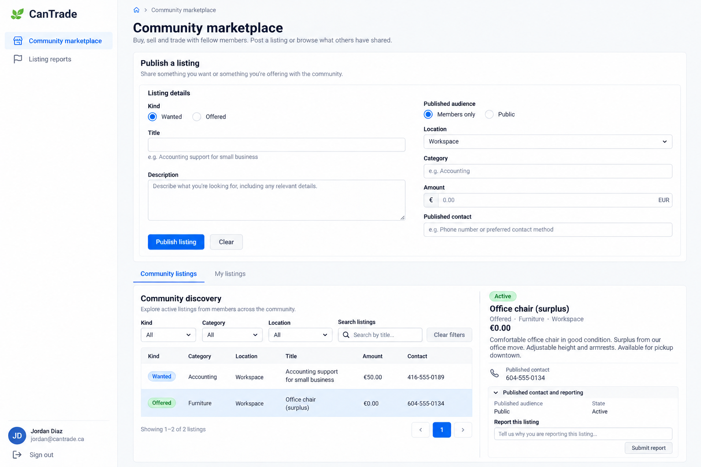
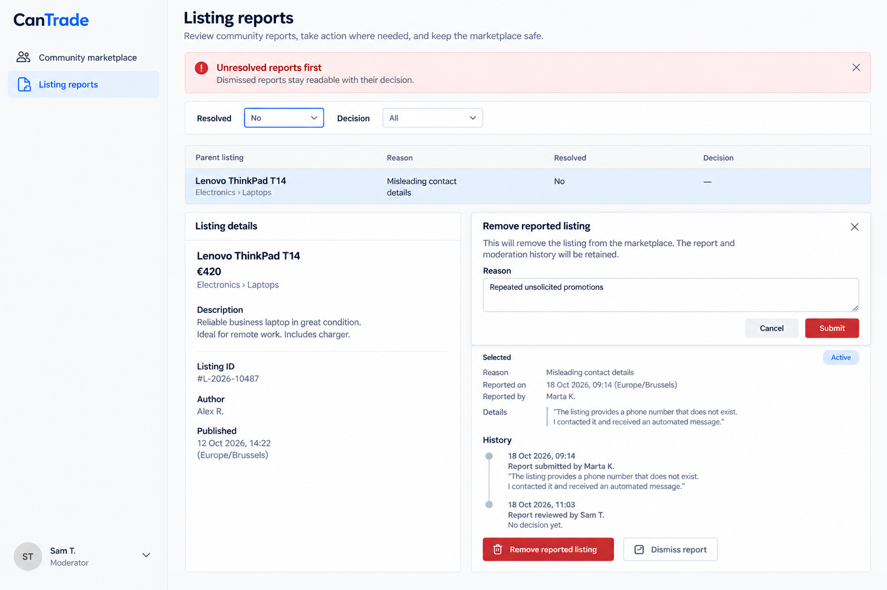

# CanTrade intended-design references

Generated UI design targets, not actual screenshots, working frontends or passing E2E tests. Built-in imagegen, 13 October 2026. [Exact prompts](prompts.md); [source](../../CanTrade.can); [requirements](../../CanTrade.md); [all apps](../../../../UI_REFERENCES.md).

## Comparison contract

Use source requirements and canonical permissions before image details. Treat meaningful differences in layout, hierarchy, source-owned content or controls, readability, responsive behavior and state presentation as visual defects. Ignore harmless antialiasing, tiny spacing, equivalent typography and illustrative data differences. Never copy an image omission, invented control, incorrect caption or sample inconsistency into product requirements.

Preserve loading, empty/no-match, failed, stale, pending/unknown and successful states as separate source-owned outcomes. They are grouped into representative layouts here, not individually exhaustive pixel baselines. Shared left-sidebar shell applies on desktop, with the account menu at the bottom left. This reference set is desktop-only by the user’s latest instruction; runtime responsive requirements remain unchanged.

## 01-community-listings-desktop.png

- Page: `/marketplace`. State: Eligible verified member/moderator; wanted/offered community discovery and publication form.
- Viewport intent: Desktop approximately1440×1000 CSS px.
- Important expectations: Description separated from publication audience/contact choices; compact filters and split listing detail; no implicit login-email publishing or checkout.
- Known limitations: Generated location/currency samples are illustrative, not new operator locations. No incidental footer copy may become a product requirement. Source caption Community listings wins over Community discovery tab. Source owner edit/status permissions are abbreviated.

## 02-moderation-desktop.png

- Page: `/marketplace/reports`. State: Moderator without owner grant; unresolved reports and removal-reason dialog.
- Viewport intent: Desktop approximately1440×1000 CSS px; modal open.
- Important expectations: Unresolved queue, original report text, moderation reason and preserved attribution/history; owner audience policy is not visible to moderator-only viewer.
- Known limitations: Dismissal/history and pagination may be abbreviated behind dialog. No generated wording adds moderation authority or author impersonation.

## Then presentation refinement

The existing `$"..."` style literal was refined after inspecting the images: retain the useful intake/detail hierarchy and aligned evidence described above. These are accepted presentation instructions; data declarations, business rules, operation bindings, admission and inline examples remain intact. Exact dimensions, brand decoration and generator mistakes were not adopted.

Coverage: desktop source page layouts are represented; inactive tabs and equivalent typed dialogs share these patterns. Own-role desktop replacements cover My shifts and volunteer assignments; no mobile references remain active. No Dutch/theme variants or every possible loading/error/empty state are separately pictured. Those requirements remain source-authoritative, and no runtime or screenshot verification is claimed.

Desktop-only revision: mobile PNGs created during this task were withdrawn after the user’s 13 October 2026 instruction. Original pre-task PNGs remain preserved. Earlier right-sidebar prompts are retained as provenance; the final left-sidebar edit prompts supersede shell direction.
