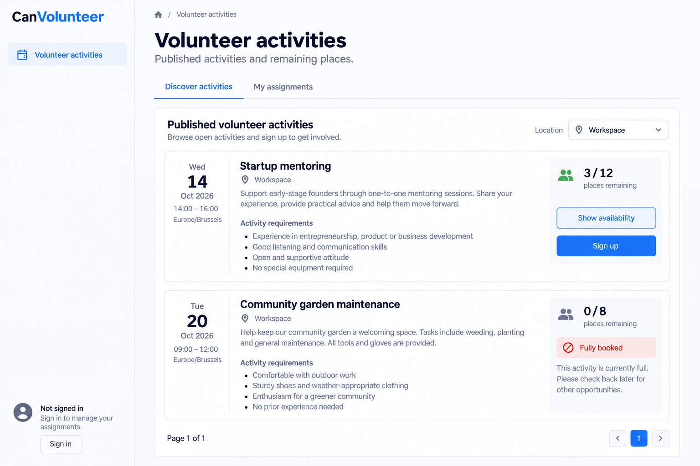
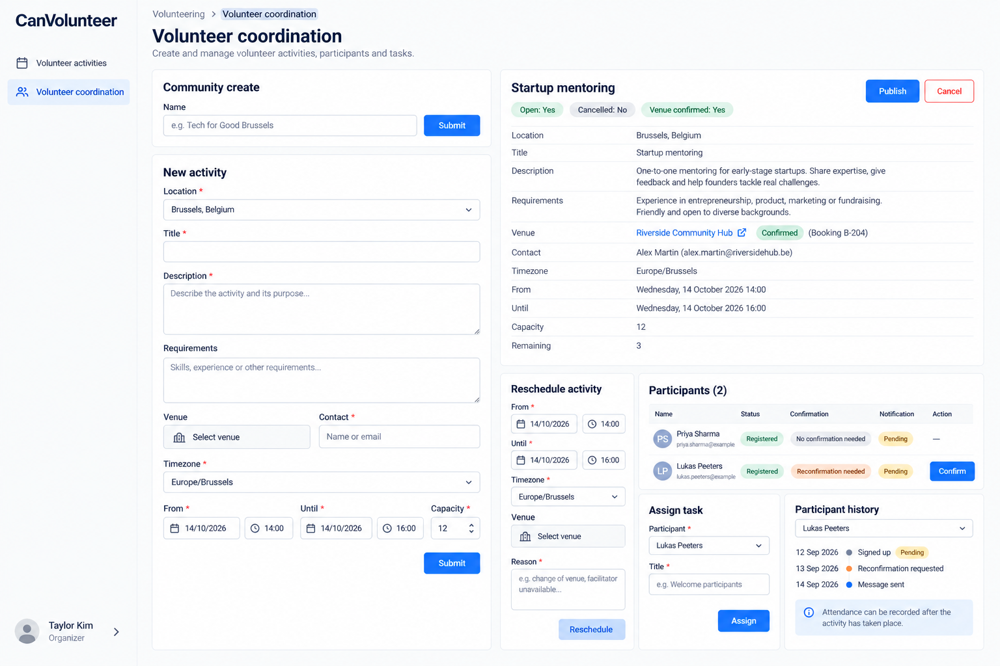
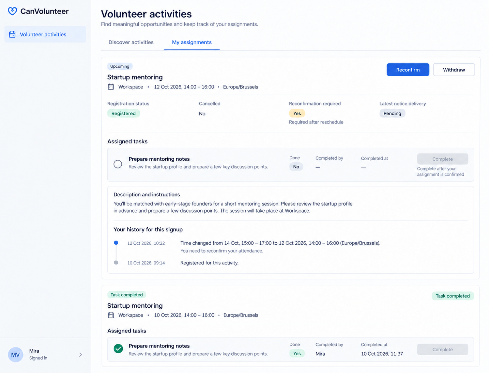

# CanVolunteer intended-design references

Generated UI design targets, not actual screenshots, working frontends or passing E2E tests. Built-in imagegen, 13 October 2026. [Exact prompts](prompts.md); [source](../../CanVolunteer.can); [requirements](../../CanVolunteer.md); [all apps](../../../../UI_REFERENCES.md).

## Comparison contract

Use source requirements and canonical permissions before image details. Treat meaningful differences in layout, hierarchy, source-owned content or controls, readability, responsive behavior and state presentation as visual defects. Ignore harmless antialiasing, tiny spacing, equivalent typography and illustrative data differences. Never copy an image omission, invented control, incorrect caption or sample inconsistency into product requirements.

Preserve loading, empty/no-match, failed, stale, pending/unknown and successful states as separate source-owned outcomes. They are grouped into representative layouts here, not individually exhaustive pixel baselines. Shared left-sidebar shell applies on desktop, with the account menu at the bottom left. This reference set is desktop-only by the user’s latest instruction; runtime responsive requirements remain unchanged.

## 01-activities-desktop.png

- Page: `/volunteering`. State: Public discovery; remaining places and full activity.
- Viewport intent: Desktop approximately1440×1000 CSS px.
- Important expectations: Date/timezone and requirements prominent; availability is a read action; capacity and remaining places explicit; private roster absent and no organizer navigation for public viewer.
- Known limitations: Activity descriptions are representative escaped text. Signup must use current authenticated/own grants; public button visibility cannot imply anonymous signup authority.

## 02-coordination-desktop.png

- Page: `/volunteering/work`. State: Organizer; activity authoring, confirmed venue, participants and task assignment.
- Viewport intent: Desktop approximately1440×1000 CSS px.
- Important expectations: Complete activity form and venue evidence; participant signup/confirmation/reconfirmation state, notification receipt and attendance remain distinct.
- Known limitations: Source schemas and grants govern omitted generated remainder/controls. Future activity cannot record completed attendance merely because a button is illustrated.

## 03-own-assignments-desktop.png

- Page: `/volunteering`, My assignments tab. State: own registered signup requiring reconfirmation, pending notice and incomplete task.
- Viewport intent: desktop, approximately1440×1100 CSS px; left sidebar.
- Important expectations: signup, cancellation/reconfirmation, notification and task completion remain separate; instructions and completion attribution remain readable; no other volunteers’ contacts or organizer navigation.
- Known limitations: historical dates and descriptive task text are illustrative. Task-completed badges are not a new Signup enum. Current source grants determine reconfirmation and completion availability.

## Then presentation refinement

The existing `$"..."` style literal was refined after inspecting the images: retain the useful intake/detail hierarchy and aligned evidence described above. These are accepted presentation instructions; data declarations, business rules, operation bindings, admission and inline examples remain intact. Exact dimensions, brand decoration and generator mistakes were not adopted.

Coverage: desktop source page layouts are represented; inactive tabs and equivalent typed dialogs share these patterns. Own-role desktop replacements cover My shifts and volunteer assignments; no mobile references remain active. No Dutch/theme variants or every possible loading/error/empty state are separately pictured. Those requirements remain source-authoritative, and no runtime or screenshot verification is claimed.

Desktop-only revision: mobile PNGs created during this task were withdrawn after the user’s 13 October 2026 instruction. Original pre-task PNGs remain preserved. Earlier right-sidebar prompts are retained as provenance; the final left-sidebar edit prompts supersede shell direction.

Inspected final limitations: the organizer image abbreviates the Link venue form and shows Confirm beside a signup requiring reconfirmation; source eligibility must disable that action until consent is current. The own-assignment image’s sample dates are inconsistent with its Upcoming label; compare the intended reconfirmation state with a valid future interval, not those incidental dates.
